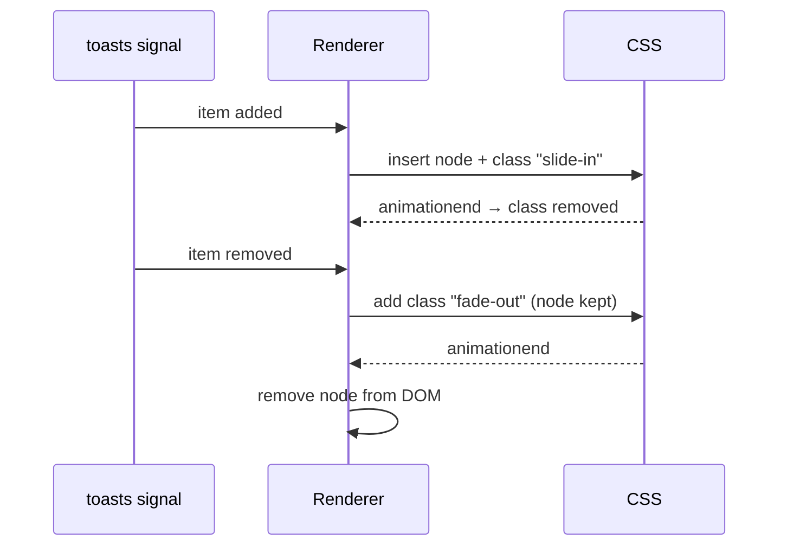

# Animations

!!! warning "v22: `@angular/animations` is deprecated"
    The npm package is marked deprecated in favour of the native **`animate.enter` / `animate.leave`** template
    features (added in v20.2). These use plain CSS and run on the compositor, with no extra library.

## `animate.enter` / `animate.leave` (modern)

```typescript
@Component({
  selector: 'app-toast-list',
  template: `
    @for (t of toasts(); track t.id) {
      <div class="toast" animate.enter="slide-in" animate.leave="fade-out">{{ t.text }}</div>
    }`,
  styles: `
    .slide-in { animation: slide-in .25s ease-out; }
    .fade-out { animation: fade-out .2s ease-in forwards; }
    @keyframes slide-in { from { transform: translateY(16px); opacity: 0; } }
    @keyframes fade-out { to { opacity: 0; transform: scale(.95); } }
  `,
})
export class ToastList { readonly toasts = input.required<Toast[]>(); }
```

Angular adds the class when the element enters and **waits for the leave animation to finish** before removing the
node. You can also bind a function: `(animate.leave)="onLeave($event)"` for JS-driven (e.g. GSAP) animations.



## Route transitions with the View Transitions API

```typescript
provideRouter(routes, withViewTransitions({ skipInitialTransition: true }))
```

```css
::view-transition-old(root) { animation: 150ms ease-out both fade-out; }
::view-transition-new(root) { animation: 250ms ease-in both fade-in; }
.restaurant-hero { view-transition-name: hero; }   /* shared-element morph between list → detail */
```

The food app enables `withViewTransitions()`, so navigating between pages cross-fades in supporting browsers.

## Legacy `@angular/animations` (for existing code)

```typescript
// app.config.ts: provideAnimationsAsync()
@Component({
  animations: [
    trigger('expand', [
      state('closed', style({ height: 0, opacity: 0 })),
      state('open', style({ height: '*', opacity: 1 })),
      transition('closed <=> open', animate('200ms ease-in-out')),
    ]),
  ],
  template: `<div [@expand]="open() ? 'open' : 'closed'">…</div>`,
})
```

Migration path: replace `:enter`/`:leave` transitions with `animate.enter`/`animate.leave` + CSS keyframes, and state
transitions with class bindings + CSS `transition`.

## Accessibility

Always respect reduced motion:

```css
@media (prefers-reduced-motion: reduce) { *, ::view-transition-group(*) { animation: none !important; transition: none !important; } }
```
