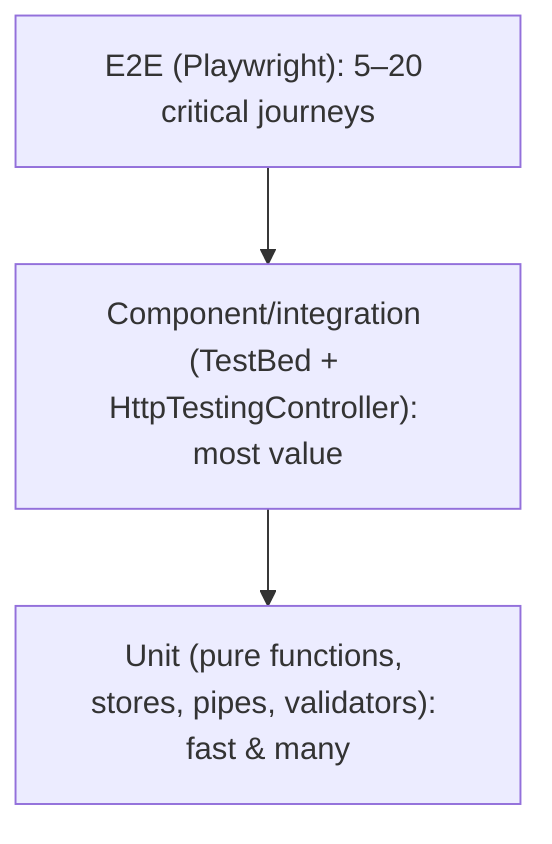

# Best Practices: Lessons from 15 Years

These are the rules I enforce on teams, from AngularJS 1.x (2011) through Angular 22. Each one exists because of a
real production incident or a painful refactor.

## Architecture

1. **Feature-first folders, not type-first.** `features/cart/{cart.page.ts, cart.store.ts}` beats
   `components/`, `services/`, `models/` at the root. Delete a feature by deleting a folder.
2. **Three layers per feature:** *data-access* (API + store), *feature* (smart pages), *ui* (dumb components).
   Dependencies point inward. Enforce with lint rules (Nx tags / `eslint-plugin-boundaries`).
3. **Components never build URLs or call `HttpClient` directly.** One API service per backend resource.
4. **State has one owner.** A signal lives in exactly one store or component. Everyone else gets `asReadonly()` and calls methods.
5. **The URL is state.** Filters, tabs, pagination and selected ids go in the route, so they're shareable and survive reload.
6. **Inject configuration** (`APP_ENV` token) instead of importing `environment` everywhere. It makes tests and runtime config trivial.
7. **Prefer composition** (host directives, functions, `inject()`) over inheritance (`BaseComponent` hierarchies rot).

## Code

| Do | Don't |
|---|---|
| `inject()` + `readonly` fields | constructor parameter soup |
| `input()`, `output()`, `model()`, `viewChild()` | decorators in new code |
| `@if` / `@for` with `track` | `*ngIf` / `*ngFor` (deprecated) |
| `computed()` for derived state | effects copying signals |
| `httpResource` / `toSignal` | manual `subscribe` + field assignment |
| `takeUntilDestroyed()` | `Subject` + `ngOnDestroy` boilerplate |
| typed reactive forms / signal forms | `UntypedFormGroup`, `any` |
| `protected` for template-only members | `public` everything |
| immutable updates | mutation (`push`, `splice`, `obj.x = …`) |
| integer minor units for money (paise/cents) | floating-point money |
| strict TS + `strictTemplates` | `// @ts-ignore`, `$any()` everywhere |

## Performance defaults

- Lazy-load every route except the landing page. `@defer` everything below the fold.
- OnPush + zoneless (defaults in v22). Don't opt out without a reason.
- Budgets in `angular.json`. Lighthouse CI in the pipeline.
- `NgOptimizedImage` for every content image.

## Testing strategy (the pyramid that actually works)

- Test **behaviour through the DOM**, not private methods.
- Fake at the boundaries (HTTP, AuthService), never the thing under test.
- Every bug fix gets a failing test first.

## Team & process

- **Upgrade every major within 1–2 months.** Skipping versions turns a one-day `ng update` into a quarter-long project.
- **Codemods over manual refactors.** Use Angular's schematics (`control-flow`, `signals`, `inject`) and write your own with `ts-morph`.
- **Design system in a library** (or Material/CDK + tokens), consumed by every app.
- **ADR (Architecture Decision Records)** for state-management, auth and MFE choices.
- **Definition of Done:** tests, a11y check, prod build passes, bundle budget OK, no console errors.

## Code review checklist

- [ ] No subscriptions without a teardown strategy
- [ ] No mutation of inputs or signal values
- [ ] `track` uses a stable id
- [ ] No business logic in templates
- [ ] Errors handled (interceptor and/or local UI)
- [ ] Loading and empty states designed
- [ ] Accessible (labels, roles, keyboard)
- [ ] No secrets or URLs hard-coded (use the env/config token)
- [ ] Tests cover the change, and the prod build passes

## Anti-patterns I've removed from real codebases

| Anti-pattern | Symptom | Cure |
|---|---|---|
| God `SharedModule` | every lazy chunk is huge | standalone imports |
| `BaseComponent` with 30 inherited members | fragile, untestable | composition with `inject()` helpers |
| Nested subscribes | race conditions, leaks | higher-order operators |
| Everything in NgRx | 5 files per checkbox | local signals / SignalStore |
| `setTimeout(() => …, 0)` to "fix" NG0100 | flicker, flakiness | `computed`, proper lifecycle |
| Components calling `HttpClient` directly | duplicated URLs and error handling | data-access services |
| `any` everywhere | runtime crashes after API changes | generated API types (OpenAPI → TS) |
