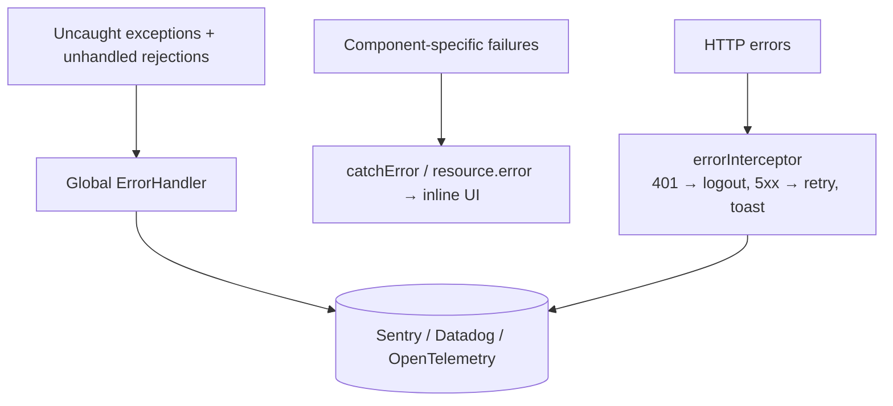

# Error Handling & Logging

## Layers



## Global `ErrorHandler`

```typescript
@Injectable()
export class AppErrorHandler implements ErrorHandler {
  private readonly env = inject(APP_ENV);
  private readonly notify = inject(NotificationService);

  handleError(error: unknown): void {
    const err = error instanceof Error ? error : new Error(String(error));
    if (error instanceof HttpErrorResponse) return;      // already handled by the interceptor
    if (!this.env.production) console.error(err);
    this.notify.show('Something went wrong. We have been notified.', 'error');
    // Sentry.captureException(err, { tags: { env: this.env.name } });
  }
}

providers: [
  provideBrowserGlobalErrorListeners(),                  // v20+: window 'error' + 'unhandledrejection' → ErrorHandler
  { provide: ErrorHandler, useClass: AppErrorHandler },
]
```

## Backend errors as RFC 9457 ProblemDetail

```json
{ "type": "https://food.example.com/problems/restaurant-closed", "title": "Restaurant closed",
  "status": 422, "detail": "This restaurant is not accepting orders", "instance": "/orders" }
```

The food app's `errorInterceptor` shows `error.detail ?? error.title`, so the backend controls the message.

## Logging service with levels per environment

```typescript
@Injectable({ providedIn: 'root' })
export class Logger {
  private readonly level = inject(APP_ENV).logLevel;           // dev: debug, prod: error
  private readonly order = ['debug', 'info', 'warn', 'error'] as const;
  private on = (l: (typeof this.order)[number]) => this.order.indexOf(l) >= this.order.indexOf(this.level);
  debug = (...a: unknown[]) => this.on('debug') && console.debug(...a);
  info = (...a: unknown[]) => this.on('info') && console.info(...a);
  warn = (...a: unknown[]) => this.on('warn') && console.warn(...a);
  error = (...a: unknown[]) => this.on('error') && console.error(...a);
}
```

## Monitoring

- **Sentry** (`@sentry/angular`): errors, release tracking, session replay, and source maps uploaded from CI
  (`"sourceMap": { "scripts": true, "hidden": true }`, as in the food app's `uat` config).
- **OpenTelemetry web** + backend traces: propagate `traceparent` via an interceptor for end-to-end traces.
- Real-user monitoring: `web-vitals` library → analytics.

## Interview corner

??? question "Why didn't my ErrorHandler catch an error inside an RxJS subscribe?"
    It did only if the error reached `subscribe` with no error callback, so RxJS rethrows it asynchronously. Errors
    swallowed by `catchError(() => EMPTY)` never reach it. Decide deliberately where each error is handled.
