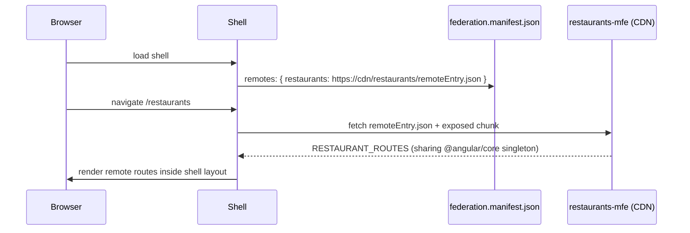

# Micro Frontends

## When (not) to use

| ✅ Consider when | ❌ Avoid when |
|---|---|
| Multiple **autonomous teams** need independent deploys | One team, one release train |
| Integrating apps built on different stacks or versions | You only want "modularity" (use lazy routes and libs) |
| Very large product with clear domain seams | Shared state across the seams is heavy |

Micro frontends trade build-time simplicity for **runtime complexity**: versioning shared deps, cross-app routing,
design consistency and performance.

## Native Federation (esbuild-compatible Module Federation)

```bash
ng add @angular-architects/native-federation --project shell --port 4200 --type dynamic-host
ng add @angular-architects/native-federation --project restaurants-mfe --port 4201 --type remote
```

```typescript title="restaurants-mfe/federation.config.js"
module.exports = withNativeFederation({
  name: 'restaurants',
  exposes: { './routes': './projects/restaurants-mfe/src/app/restaurant.routes.ts' },
  shared: { ...shareAll({ singleton: true, strictVersion: true, requiredVersion: 'auto' }) },
});
```

```typescript title="shell/app.routes.ts"
{ path: 'restaurants', loadChildren: () => loadRemoteModule('restaurants', './routes').then((m) => m.RESTAURANT_ROUTES) }
```



Alternatives: **Web Components** via Angular Elements (stack-agnostic), iframes (strong isolation), and
server-side composition.
