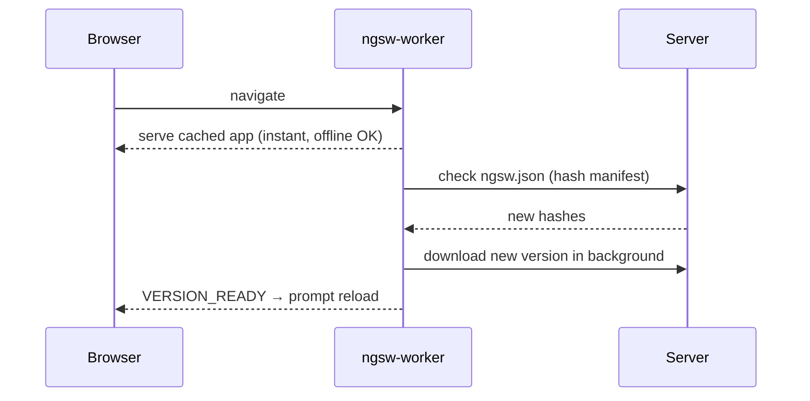

# PWA & Service Worker

```bash
ng add @angular/pwa      # manifest.webmanifest, icons, ngsw-config.json, provideServiceWorker()
```

```typescript title="app.config.ts"
provideServiceWorker('ngsw-worker.js', {
  enabled: !isDevMode(),
  registrationStrategy: 'registerWhenStable:30000',
})
```

```json title="ngsw-config.json"
{
  "index": "/index.html",
  "assetGroups": [
    { "name": "app", "installMode": "prefetch", "resources": { "files": ["/favicon.ico", "/index.html", "/*.css", "/*.js"] } },
    { "name": "assets", "installMode": "lazy", "updateMode": "prefetch", "resources": { "files": ["/assets/**", "/*.(svg|png|webp)"] } }
  ],
  "dataGroups": [
    { "name": "restaurants", "urls": ["/api/restaurants**"],
      "cacheConfig": { "strategy": "freshness", "maxSize": 50, "maxAge": "1h", "timeout": "3s" } },
    { "name": "menus", "urls": ["/api/restaurants/*/menu"],
      "cacheConfig": { "strategy": "performance", "maxSize": 100, "maxAge": "1d" } }
  ]
}
```

`freshness` = network first, fall back to cache (lists). `performance` = cache first (static-ish data).

## Prompting users to update

```typescript
@Injectable({ providedIn: 'root' })
export class AppUpdates {
  constructor() {
    const sw = inject(SwUpdate);
    if (!sw.isEnabled) return;
    sw.versionUpdates.pipe(filter((e): e is VersionReadyEvent => e.type === 'VERSION_READY'))
      .subscribe(() => confirm('A new version is available. Reload?') && document.location.reload());
    sw.unrecoverable.subscribe(() => document.location.reload());
  }
}
```



Test it with `ng build && npx http-server -p 8080 dist/food-delivery-app/browser`. The service worker doesn't run under `ng serve`.
