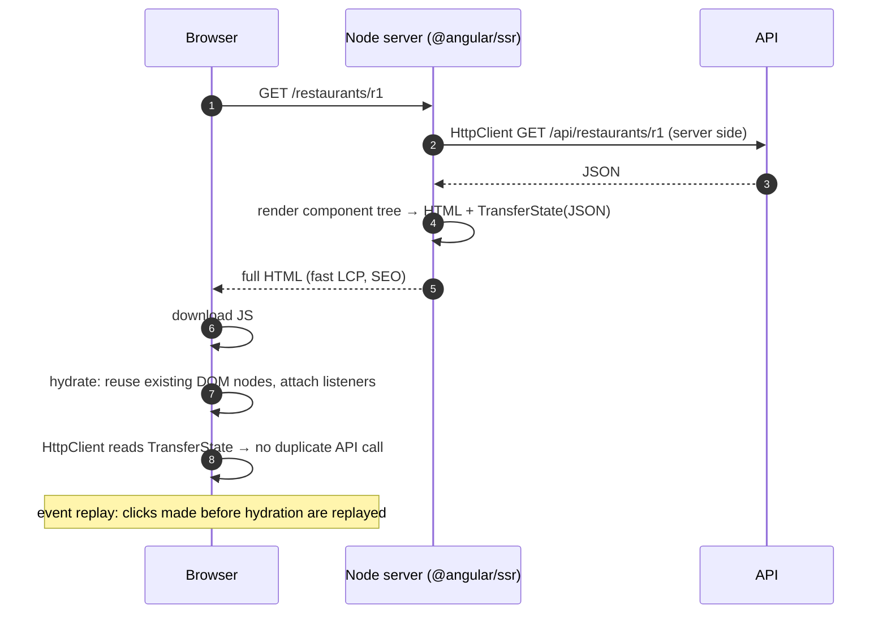

# SSR, Prerendering & Hydration

```bash
ng new food-app --ssr              # or for an existing app:
ng add @angular/ssr
npm run build && npm run serve:ssr:food-app   # node dist/food-app/server/server.mjs
```

## Render modes per route (v19+)

```typescript title="app.routes.server.ts"
import { RenderMode, ServerRoute } from '@angular/ssr';

export const serverRoutes: ServerRoute[] = [
  { path: '', renderMode: RenderMode.Prerender },                    // SSG at build time
  { path: 'restaurants/:id', renderMode: RenderMode.Prerender,
    async getPrerenderParams() { return (await fetchTopIds()).map((id) => ({ id })); } },
  { path: 'orders/**', renderMode: RenderMode.Client },              // private, CSR only
  { path: '**', renderMode: RenderMode.Server },                     // SSR on each request
];
```

## How hydration works



```typescript
provideClientHydration(
  withEventReplay(),            // default for new apps
  withIncrementalHydration(),   // enabled by default in v22 (opt out: withNoIncrementalHydration())
  withHttpTransferCacheOptions({ includePostRequests: false }),
)
```

## Incremental hydration

```html
@defer (hydrate on viewport) {
  <app-reviews />          <!-- server-rendered HTML, JS downloaded + hydrated only when visible -->
}
@defer (hydrate on interaction) { <app-menu-filters /> }
@defer (hydrate never) { <app-static-footer /> }
```

## Writing SSR-safe code

```typescript
private readonly platformId = inject(PLATFORM_ID);
if (isPlatformBrowser(this.platformId)) { localStorage.getItem('x'); }

// Better: browser-only APIs inside afterNextRender (never runs on the server)
afterNextRender(() => { this.chart = new Chart(this.canvas().nativeElement, cfg); });

// Use DOCUMENT instead of document
private readonly doc = inject(DOCUMENT);
```

| Problem | Cause | Fix |
|---|---|---|
| `NG0500` hydration mismatch | DOM differs between server and client (random ids, dates, invalid HTML like `<p><div>`) | deterministic render, valid HTML, `ngSkipHydration` as last resort |
| `localStorage is not defined` | browser API on server | `afterNextRender` / `isPlatformBrowser` |
| App never stabilises (SSR hangs) | never-completing timers or `interval` on the server | start them in `afterNextRender` |
| Double API calls | no transfer cache | HttpClient transfer cache (default) |

## Interview corner

??? question "SSR vs prerendering (SSG) vs CSR?"
    SSG renders at **build time** (fastest, cacheable, for content that changes rarely). SSR renders **per request**
    (fresh, personalised, needs a Node runtime). CSR renders in the browser (cheapest hosting, worse LCP and SEO).
    Since v19 you can mix them per route.

??? question "What is event replay?"
    Clicks that happen before hydration finishes are recorded (via the JSAction contract) and replayed afterwards, so
    early user interactions aren't lost.
