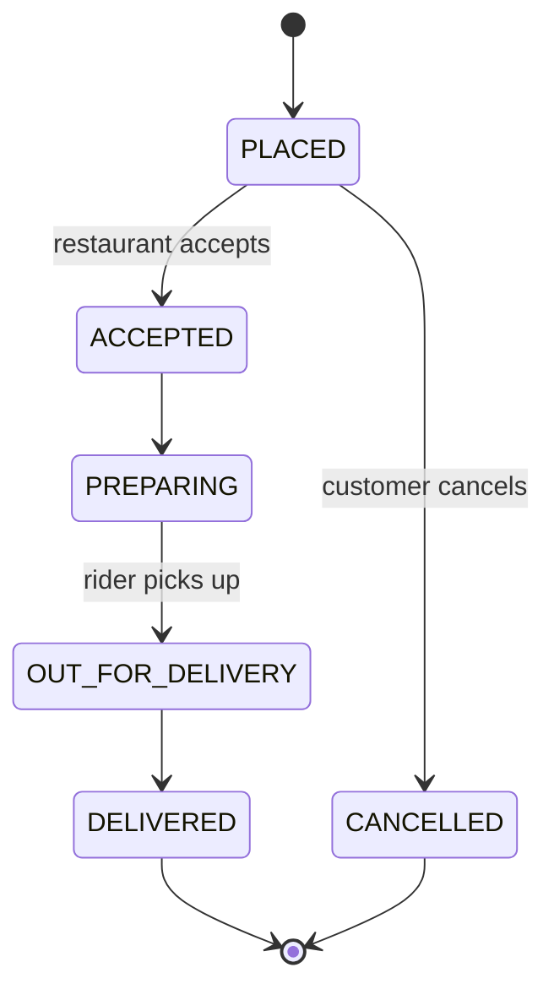
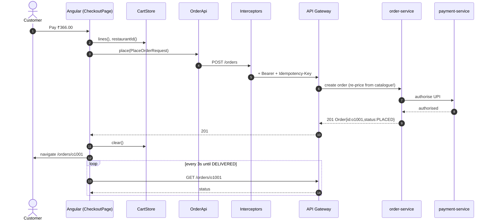

# Backend API Contract

The Angular app talks to a REST API under `${apiBaseUrl}` (`/api` in dev, `https://api.<env>.food.example.com` elsewhere).
In dev, the **mock-API interceptor** implements this exact contract in the browser, so the UI and its tests run with no server.

## Conventions

- JSON over HTTPS. Money is an **integer in paise** (`32000` = ₹320.00).
- Auth: `Authorization: Bearer <JWT>` (or a BFF session cookie).
- Mutating requests send `Idempotency-Key: <uuid>` (added by `idempotencyInterceptor`).
- Errors are **RFC 9457 ProblemDetail**: `{ type, title, status, detail, instance }`.
- Timestamps are ISO-8601 UTC.

## Endpoints

| Method | Path | Auth | Description |
|---|---|---|---|
| POST | `/auth/login` | — | email + password → access token + user |
| GET | `/restaurants?q=&vegOnly=&sort=rating\|deliveryTime\|costLow` | — | search/list |
| GET | `/restaurants/{id}` | — | restaurant details |
| GET | `/restaurants/{id}/menu` | — | menu items |
| POST | `/orders` | CUSTOMER | place order (server recalculates price) |
| GET | `/orders` | CUSTOMER | my orders (ADMIN: all) |
| GET | `/orders/{id}` | owner/ADMIN | order with current status |
| POST | `/orders/{id}/cancel` | owner | cancel while `PLACED` |

### `POST /auth/login`

=== "Request"

    ```json
    { "email": "customer@food.dev", "password": "password" }
    ```

=== "200 Response"

    ```json
    {
      "accessToken": "eyJhbGciOi…",
      "expiresIn": 3600,
      "user": { "id": "u1", "name": "Asha Customer", "email": "customer@food.dev", "roles": ["CUSTOMER"] }
    }
    ```

=== "401 Response"

    ```json
    { "type": "about:blank", "title": "Unauthorized", "status": 401, "detail": "Invalid email or password" }
    ```

### `GET /restaurants?q=spice&sort=rating`

```json
[
  { "id": "r1", "name": "Spice Route", "cuisine": ["North Indian", "Mughlai"], "rating": 4.5,
    "deliveryTimeMins": 30, "costForTwo": 60000, "emoji": "🍛", "isOpen": true, "isVeg": false }
]
```

### `GET /restaurants/r1/menu`

```json
[
  { "id": "m1", "restaurantId": "r1", "name": "Butter Chicken", "description": "Creamy tomato gravy, tandoori chicken",
    "price": 32000, "isVeg": false, "category": "Mains", "bestseller": true },
  { "id": "m3", "restaurantId": "r1", "name": "Garlic Naan", "description": "Tandoor baked",
    "price": 6000, "isVeg": true, "category": "Breads" }
]
```

### `POST /orders`

=== "Request"

    ```http
    POST /api/orders
    Authorization: Bearer eyJ…
    Idempotency-Key: 6f1c2a9e-0d1b-4d8e-9a77-0c3b2f1e9d10
    Content-Type: application/json

    {
      "restaurantId": "r1",
      "lines": [{ "menuItemId": "m1", "qty": 1 }],
      "address": { "line1": "12 MG Road", "city": "Bengaluru", "pincode": "560001" },
      "paymentMethod": "UPI"
    }
    ```

=== "201 Response"

    ```json
    { "id": "o1001", "restaurantId": "r1", "restaurantName": "Spice Route", "total": 36600,
      "status": "PLACED", "placedAt": "2026-11-02T18:41:20Z", "etaMins": 30 }
    ```

=== "422 Response"

    ```json
    { "type": "https://food.example.com/problems/restaurant-closed", "title": "Restaurant closed",
      "status": 422, "detail": "This restaurant is not accepting orders" }
    ```

### `GET /orders/{id}`: status machine



## End-to-end order sequence



!!! warning "Never trust client-side prices"
    The cart computes totals for display only. The server **recomputes** totals from its catalogue and rejects
    tampered requests. The mock API does the same (`subtotal + delivery + GST`).

## TypeScript models (shared with the API)

```typescript title="core/models/models.ts"
--8<-- "src/app/core/models/models.ts"
```

!!! tip "Generate these from OpenAPI"
    In real projects, generate models and clients from the backend's OpenAPI spec
    (`npx @openapitools/openapi-generator-cli generate -g typescript-angular` or `orval`), so the front-end can't
    drift from the contract.
