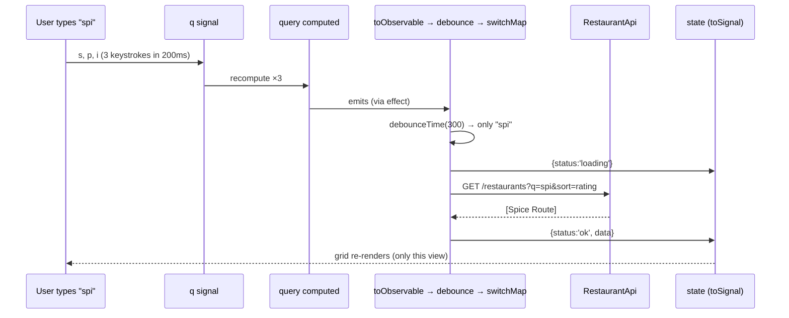

# Code Walkthrough

## Folder structure

```text
examples/food-delivery-app/
├── angular.json            # build configs: development, qa, uat, production
├── Dockerfile  nginx.conf  .dockerignore
├── playwright.config.ts    e2e/order-flow.spec.ts
├── proxy.conf.json         # /api → localhost:8080 when useMockApi=false
└── src/
    ├── environments/       # environment.{ts,qa,uat,prod}.ts + model
    ├── styles.scss         # design tokens, dark mode
    └── app/
        ├── app.ts  app.config.ts  app.routes.ts
        ├── core/
        │   ├── api/        restaurant-api.ts  order-api.ts
        │   ├── auth/       auth.service.ts  auth.guards.ts
        │   ├── http/       auth / error / idempotency / loading interceptors
        │   ├── mock/       mock-api.interceptor.ts  mock-data.ts
        │   ├── models/     models.ts
        │   └── config.ts   APP_ENV token
        ├── shared/         pipes/inr.pipe.ts  directives/has-role.directive.ts  ui/*
        ├── layout/         header.ts  toasts.ts  status-pages.ts
        └── features/
            ├── restaurants/  restaurant-list.page.ts  restaurant-menu.page.ts  restaurant-card.ts
            ├── cart/         cart.store.ts  cart.page.ts
            ├── checkout/     checkout.page.ts  pincode.validator.ts  unsaved-changes.guard.ts
            ├── orders/       orders.page.ts  order-tracking.page.ts  order-feedback.ts  order-status.pipe.ts
            ├── auth/         login.page.ts
            └── admin/        admin.routes.ts  admin-dashboard.page.ts
```

## 1. Bootstrapping & providers

```typescript title="app.config.ts"
--8<-- "src/app/app.config.ts"
```

## 2. Routes

```typescript title="app.routes.ts"
--8<-- "src/app/app.routes.ts"
```

## 3. Restaurant list: signals + RxJS together

```typescript title="features/restaurants/restaurant-list.page.ts"
--8<-- "src/app/features/restaurants/restaurant-list.page.ts"
```



## 4. Presentational card

```typescript title="features/restaurants/restaurant-card.ts"
--8<-- "src/app/features/restaurants/restaurant-card.ts"
```

## 5. Menu page with `httpResource`

```typescript title="features/restaurants/restaurant-menu.page.ts"
--8<-- "src/app/features/restaurants/restaurant-menu.page.ts"
```

## 6. Checkout (typed reactive form + guards)

```typescript title="features/checkout/checkout.page.ts"
--8<-- "src/app/features/checkout/checkout.page.ts"
```

```typescript title="features/checkout/unsaved-changes.guard.ts"
--8<-- "src/app/features/checkout/unsaved-changes.guard.ts"
```

## 7. Order API & live tracking

```typescript title="core/api/order-api.ts"
--8<-- "src/app/core/api/order-api.ts"
```

```typescript title="features/orders/order-tracking.page.ts"
--8<-- "src/app/features/orders/order-tracking.page.ts"
```

## 8. Mock backend interceptor

```typescript title="core/mock/mock-api.interceptor.ts"
--8<-- "src/app/core/mock/mock-api.interceptor.ts"
```

## 9. Layout: header with env badge & role-based link

```typescript title="layout/header.ts"
--8<-- "src/app/layout/header.ts"
```

## Switching from mock to a real backend

1. Set `useMockApi: false` in `environment.ts` (qa/uat/prod already have it off).
2. Run the backend on `localhost:8080`. `proxy.conf.json` forwards `/api` there.
3. `npm start`. Same UI, real data.
