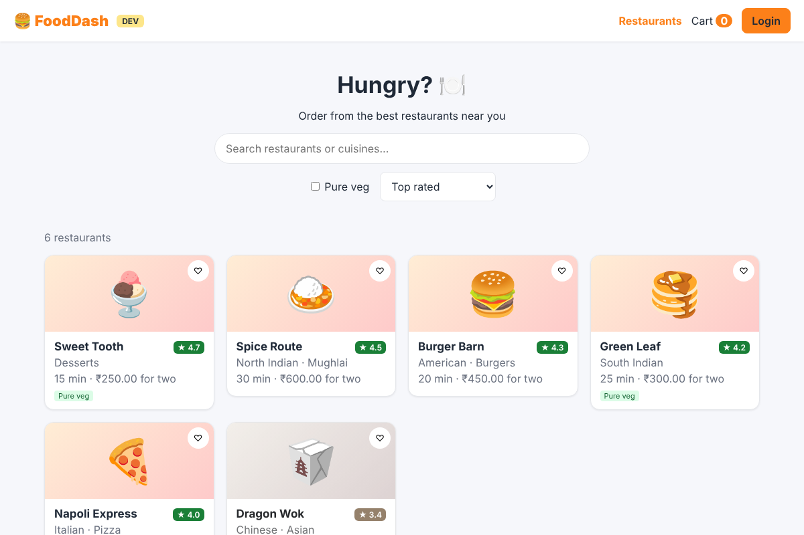
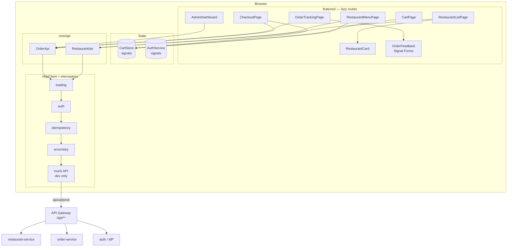
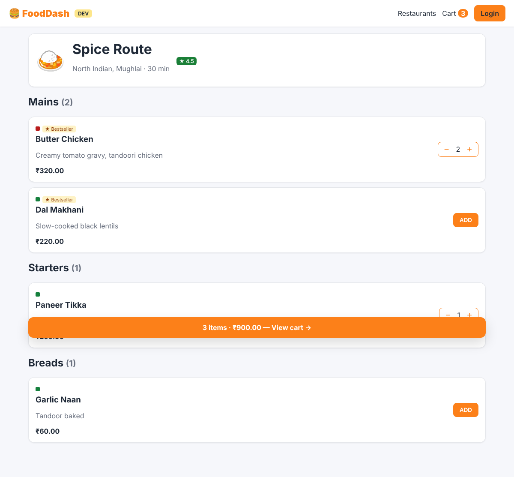
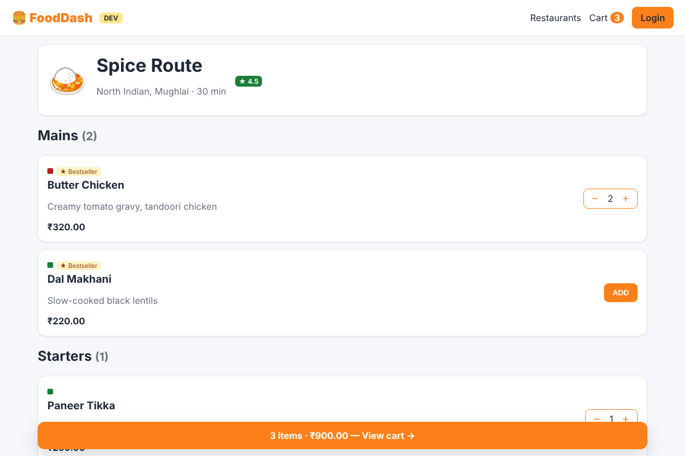
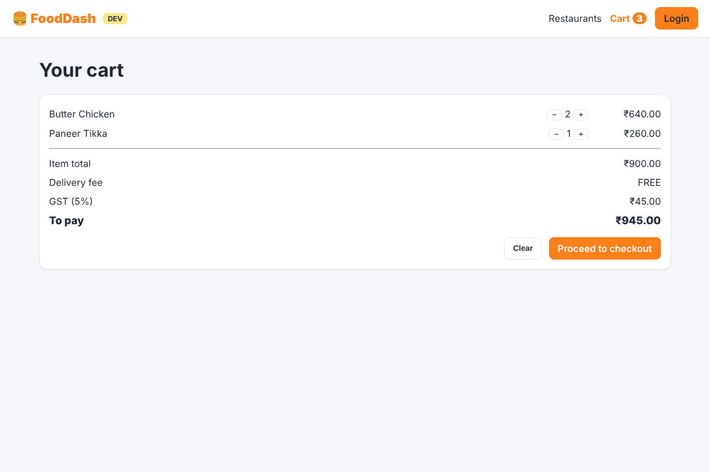
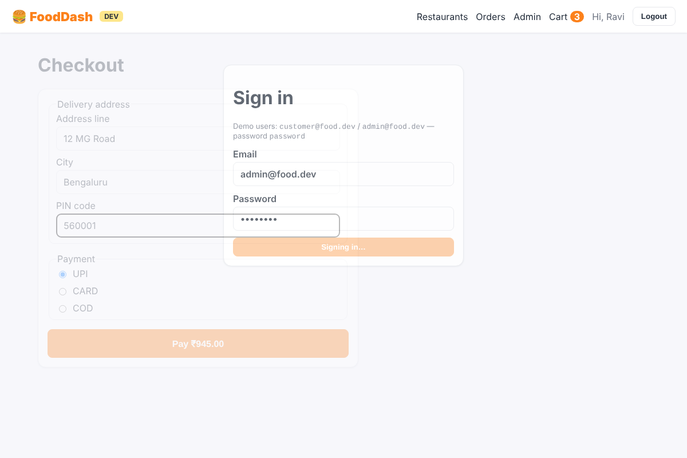
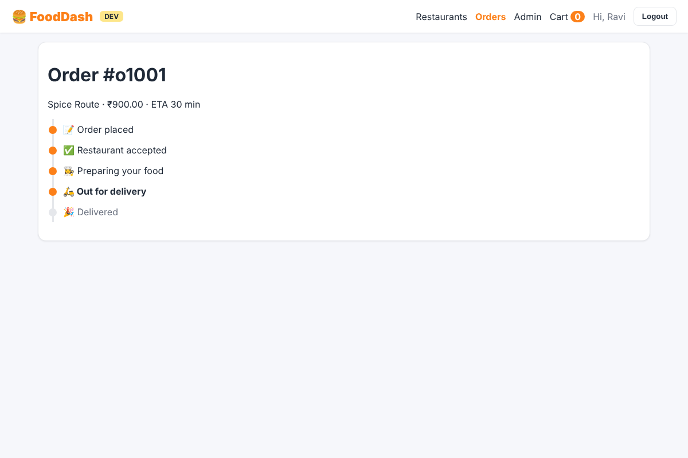
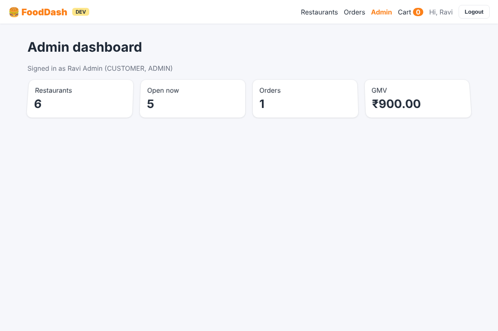

# Case Study: FoodDash Food Delivery App

A complete Angular 22 app in `examples/food-delivery-app`. Browse restaurants, view menus, manage the cart, log in,
check out, track the order live and rate it, plus an admin dashboard behind role-based access.



## Run it

```bash
cd examples/food-delivery-app
npm ci
npm start                     # http://localhost:4200 (mock API, no backend needed)
```

Demo users (mock API): `customer@food.dev` / `password` (CUSTOMER) and `admin@food.dev` / `password` (CUSTOMER + ADMIN).

## Feature → Angular concept map

| Feature | Angular concepts used |
|---|---|
| Restaurant list with search, veg filter, sort | signals, `computed`, `toObservable` + `debounceTime` + `switchMap`, `toSignal`, `@switch`, `@for … @empty`, skeletons, `@defer (on viewport)` |
| Restaurant card | presentational component, `input.required`, `output`, custom pipe, child component |
| Menu page `/restaurants/:id` | `withComponentInputBinding`, **`httpResource`**, `computed` grouping, `@let` |
| Cart | **signal store** service, `effect` → localStorage, business rules in `computed` |
| Login | typed reactive form, `NonNullableFormBuilder`, `returnUrl` input from query param |
| Checkout | nested `FormGroup`, custom validator, **`canDeactivate`** unsaved-changes guard, `authGuard` |
| Order tracking | RxJS polling (`timer` + `switchMap` + `takeWhile`), `takeUntilDestroyed`, timeline UI |
| Rate order | **Signal Forms** (`form`, `[formField]`, `validate`, `submit`) inside `@defer` |
| Admin dashboard | **`canMatch` role guard** on lazy `loadChildren`, `*appHasRole` directive |
| Cross-cutting | functional interceptors (auth, error/retry, idempotency key, loading), mock-backend interceptor, toasts, env badge |
| Environments | dev / qa / uat / prod via `fileReplacements` + `APP_ENV` token |
| Quality | 52 Vitest tests (incl. interview challenges), Playwright E2E, Docker + Nginx, GitHub Actions |

## Architecture



## Screens

| | |
|---|---|
| { .screen } | { .screen } |
| { .screen } | { .screen } |
| { .screen } | { .screen } |

These screenshots were captured by Playwright from the running app.

Continue to [UI Design](ui-design.md), then the [API Contract](api-contract.md) and the [Code Walkthrough](code-walkthrough.md).
