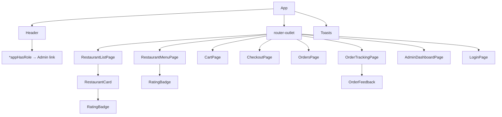
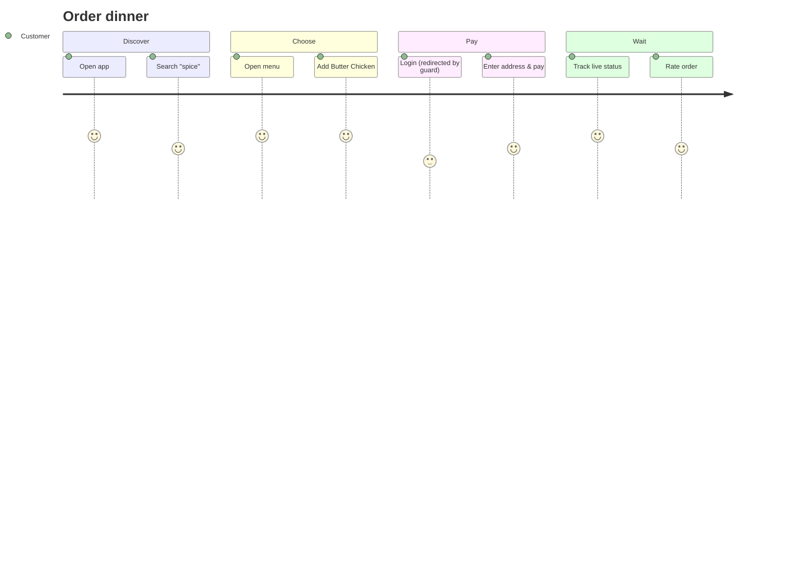

# UI Design

## Design principles

1. **Speed to food.** Search and the restaurant grid sit above the fold, and two taps reach the menu.
2. **Always-visible cart.** A badge in the header plus a sticky "View cart" bar on the menu page.
3. **Trust at checkout.** A transparent bill breakdown (item total, delivery, GST) and a clear CTA "Pay ₹366.00".
4. **Live feedback.** A loading bar, toasts with `aria-live`, and a timeline for order tracking.
5. **Accessible and themeable.** Semantic HTML, a 3D hover depth effect that respects `prefers-reduced-motion`,
   automatic dark mode, and CSS tokens.

## Design tokens

| Token | Light | Dark | Use |
|---|---|---|---|
| `--brand` | `#fc8019` | `#fc8019` | CTAs, active nav, badges |
| `--bg` | `#f6f7fb` | `#0f172a` | page |
| `--surface` | `#ffffff` | `#1e293b` | cards, header |
| `--text` / `--muted` | `#1f2937` / `#6b7280` | `#e2e8f0` / `#94a3b8` | text |
| `--shadow` / `--shadow-lg` | soft / deep | — | depth (3D lift on hover) |
| radius | 14 px cards, 8 px buttons, 999 px pills | | |

## Wireframes

```text
┌──────────────────────────────────────────────────────────────────────┐
│ 🍔 FoodDash [DEV]            Restaurants  Orders  Admin  Cart(2) Logout│  ← sticky header
├──────────────────────────────────────────────────────────────────────┤
│                         Hungry? 🍽️                                    │
│            ( 🔍 Search restaurants or cuisines…        )              │
│                  [✓] Pure veg   [ Top rated ▾ ]                       │
│  6 restaurants                                                        │
│  ┌────────┐ ┌────────┐ ┌────────┐ ┌────────┐                          │
│  │  🍨  ♡ │ │  🍛  ♡ │ │  🍔  ♡ │ │  🥞  ♡ │   ← cards lift + tilt    │
│  │Sweet T.│ │Spice R.│ │Burger B│ │Green L.│      on hover            │
│  │★4.7    │ │★4.5    │ │★4.3    │ │★4.2    │                          │
│  │15m ₹250│ │30m ₹600│ │20m ₹450│ │25m ₹300│                          │
│  └────────┘ └────────┘ └────────┘ └────────┘                          │
│  ┌──────────────────────────────────────────────┐ ← @defer on viewport│
│  │ 🎉 50% off on your first order  WELCOME50     │                    │
└──────────────────────────────────────────────────────────────────────┘

MENU /restaurants/:id                      CART /cart
┌──────────────────────────────┐          ┌───────────────────────────────┐
│ 🍛 Spice Route        ★4.5    │          │ Butter Chicken  [−2+]  ₹640.00 │
│ North Indian · 30 min         │          │ Garlic Naan     [−1+]   ₹60.00 │
│ Mains (2)                     │          │ ───────────────────────────── │
│ ┌───────────────────────────┐ │          │ Item total             ₹700.00 │
│ │■ ★Bestseller              │ │          │ Delivery fee              FREE │
│ │Butter Chicken      [−2+]  │ │          │ GST (5%)                ₹35.00 │
│ │₹320.00                    │ │          │ To pay                 ₹735.00 │
│ └───────────────────────────┘ │          │      [Clear] [Proceed to checkout]
│ [ 3 items · ₹700 — View cart→]│ ← sticky └───────────────────────────────┘
└──────────────────────────────┘

TRACK /orders/:id
┌──────────────────────────────┐
│ Order #o1001                 │
│ ● 📝 Order placed            │
│ ● ✅ Restaurant accepted     │
│ ● 👩‍🍳 Preparing             │
│ ◉ 🛵 Out for delivery  ← now │
│ ○ 🎉 Delivered               │
│ [Rate your order] (Signal Forms, deferred)
└──────────────────────────────┘
```

## Component tree



## User journey



## States every screen designs for

| State | List page | Menu | Cart | Tracking |
|---|---|---|---|---|
| Loading | 4 shimmer skeleton cards | "Loading menu…" | — | "Loading order…" |
| Empty | "No restaurants match …" | — | 🛒 empty + CTA | — |
| Error | message + **Retry** | "Restaurant not found" + back link | toast | toast |
| Success | grid | grouped menu + sticky cart bar | bill | timeline |
