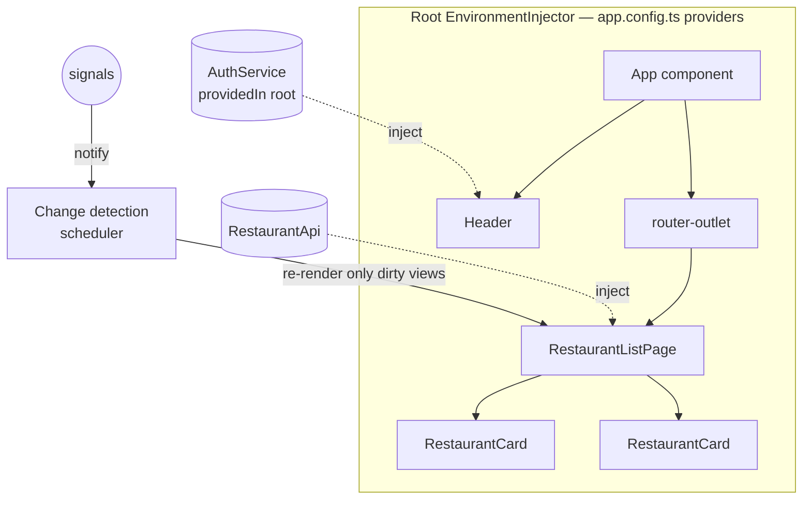
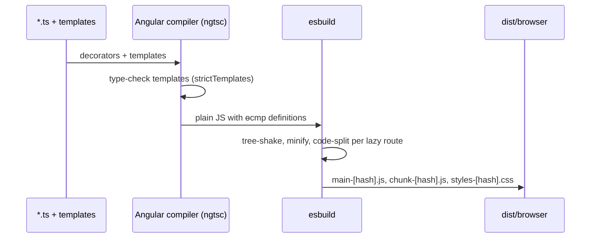

# Architecture & Bootstrapping

## The mental model

An Angular app is a **tree of components**. Each component has a template, a class and metadata.
**Dependency injection** supplies services to that tree. The **router** swaps sub-trees based on the URL,
and **change detection** keeps the DOM in sync with state, driven by **signals** in modern Angular.



## Standalone bootstrapping (v14+, default since v17)

```typescript title="src/main.ts"
import { bootstrapApplication } from '@angular/platform-browser';
import { appConfig } from './app/app.config';
import { App } from './app/app';

bootstrapApplication(App, appConfig).catch((err) => console.error(err));
```

```typescript title="src/app/app.config.ts"
export const appConfig: ApplicationConfig = {
  providers: [
    provideBrowserGlobalErrorListeners(),            // v20+: window.onerror → ErrorHandler
    provideRouter(routes, withComponentInputBinding()),
    provideHttpClient(withInterceptors([authInterceptor])),
    provideAppInitializer(() => inject(ConfigService).load()), // runs before first render
    { provide: LOCALE_ID, useValue: 'en-IN' },
  ],
};
```

!!! info "Zoneless is the default (v21+)"
    New apps don't load `zone.js`. Change detection is scheduled by **signals**, template **event listeners**,
    `markForCheck()`, `AsyncPipe` and `ComponentRef.setInput()`.
    Legacy apps can keep zones with `provideZoneChangeDetection({ eventCoalescing: true })`.

## NgModule bootstrapping (legacy, still supported)

```typescript
@NgModule({
  declarations: [AppComponent, HeaderComponent],
  imports: [BrowserModule, HttpClientModule, AppRoutingModule],
  providers: [{ provide: HTTP_INTERCEPTORS, useClass: AuthInterceptor, multi: true }],
  bootstrap: [AppComponent],
})
export class AppModule {}

platformBrowserDynamic().bootstrapModule(AppModule);
```

| Concern | NgModule world | Standalone world |
|---|---|---|
| Declare a component | `declarations: []` in a module | `@Component({ imports: [...] })` |
| App providers | `AppModule.providers` | `ApplicationConfig.providers` |
| Lazy load | `loadChildren: () => import(...).then(m => m.FeatureModule)` | `loadComponent` / `loadChildren` (routes) |
| Library config | `forRoot()` / `forChild()` | `provideX()` functions returning `EnvironmentProviders` |
| Use a module in standalone | — | `imports: [SomeModule]` or `importProvidersFrom(SomeModule)` |

## Compilation: JIT vs AOT

Angular compiles templates into JavaScript instructions (`ɵɵelementStart`, `ɵɵtext`…). With the **Ivy** renderer
and **AOT** (ahead-of-time, the default for everything including tests), that happens at build time:

- template errors become **build errors** (`strictTemplates` is on by default in v22)
- no compiler is shipped to the browser, so bundles are smaller
- tree-shaking works at the component level ("locality")



## Interview corner

??? question "What happens when you run `ng serve`?"
    The CLI resolves the `serve` target → `@angular/build:dev-server`, which runs the `application` builder
    (esbuild) in watch mode and serves the output through **Vite's** dev server with HMR. Templates are AOT-compiled.
    Changes trigger incremental rebuilds, and style or template changes are hot-swapped without a full reload.

??? question "Why did Angular move away from NgModules?"
    NgModules added a second dependency graph on top of ES modules. That caused confusing "declared in two modules"
    errors, made lazy loading module-shaped, hurt tree-shaking and slowed learning. Standalone components
    declare their own template dependencies (`imports`), so the **ES module graph is the only graph**.

??? question "`provideAppInitializer` vs a route resolver?"
    `provideAppInitializer` blocks **app bootstrap** (use it for global config, feature flags or auth discovery).
    A resolver blocks **one navigation** (use it for page data). Keep initializers fast, because they delay first paint.
