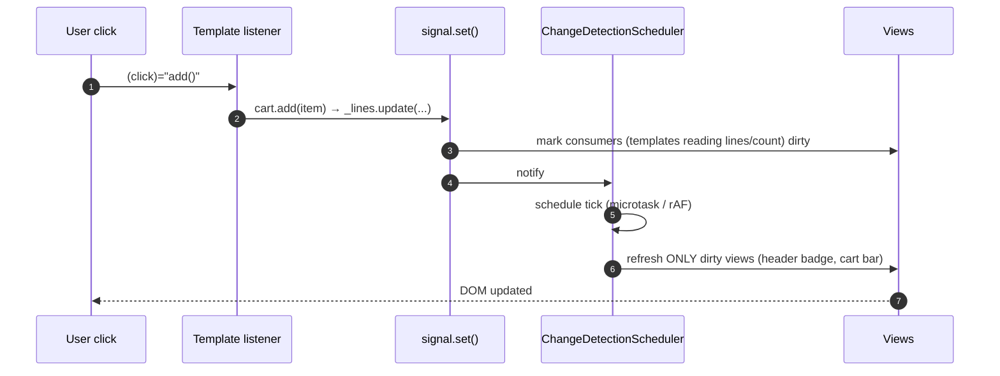

# Change Detection & Zoneless

Change detection (CD) is how Angular keeps the **DOM in sync with component state**.

## Three eras

| Era | Trigger | Granularity |
|---|---|---|
| **zone.js + Default** (≤ v16 typical) | zone.js patches every async API (click, setTimeout, XHR) → `ApplicationRef.tick()` | checks **every** component, top-down |
| **zone.js + OnPush** | same tick, but OnPush components are skipped unless dirty | subtree |
| **Zoneless + signals** (default v21+, OnPush default v22) | signal writes, template events, `markForCheck`, `async` pipe, `setInput` | only views that read changed signals (plus ancestors marked for traversal) |



## OnPush rules (when is an OnPush component checked?)

1. A **signal read in its template** changed.
2. An **`input()` / `@Input`** reference changed (`===`).
3. A **DOM event** fired inside the component or its children.
4. `async` pipe emitted.
5. `ChangeDetectorRef.markForCheck()` was called.

```typescript
// ❌ Mutation: OnPush child never sees it
this.user.name = 'New';
// ✅ New reference
this.user = { ...this.user, name: 'New' };
// ✅✅ Signal
this.user.update((u) => ({ ...u, name: 'New' }));
```

## v22: OnPush by default, `Eager` to opt out

```typescript
@Component({ selector: 'app-legacy-grid', changeDetection: ChangeDetectionStrategy.Eager, … })
export class LegacyGrid {}  // behaves like the old "Default": checked on every tick
```

When you `ng update` to 22, the `change-detection-eager` migration adds `Eager` to every existing component
that didn't specify a strategy, so behaviour doesn't change. Then you remove it component by component.

## Zoneless setup

```typescript
// v21+ new apps: nothing to do (no zone.js in angular.json polyfills)
// Migrating an existing app:
providers: [provideZonelessChangeDetection()]   // v20.2+ stable name
// and remove "zone.js" from angular.json → build.options.polyfills and test polyfills
```

**Checklist before going zoneless:**

- [x] State that the template reads is held in signals, or the code calls `markForCheck()`
- [x] No reliance on `NgZone.onStable` / `onMicrotaskEmpty` (use `afterNextRender`)
- [x] Tests use `await fixture.whenStable()` instead of `fakeAsync`/`tick` that depend on zone
- [x] Third-party libs that need zones are wrapped or upgraded

## Manual control (`ChangeDetectorRef`)

| API | Effect |
|---|---|
| `markForCheck()` | mark this view and its ancestors dirty, schedule CD |
| `detectChanges()` | synchronously check this view and its children now |
| `detach()` / `reattach()` | take a subtree out of CD (high-frequency widgets) |
| `checkNoChanges()` | dev-mode verification |

## Interview corner

??? question "What does zone.js actually do?"
    It monkey-patches async browser APIs (`addEventListener`, `setTimeout`, `Promise.then`, XHR…) so Angular knows
    *something* async finished and runs `tick()`. Costs: ~30 KB, a CD pass on every async event (even irrelevant
    ones), confusing stack traces, and it can't patch native `async/await`. Signals tell Angular exactly *what* changed instead.

??? question "With zoneless, why didn't my `setTimeout(() => this.x = 5)` update the view?"
    Nothing notified the scheduler. Make `x` a signal (`this.x.set(5)`), or call `markForCheck()`.

??? question "Explain `NG0100` in zoneless apps."
    It still exists in dev mode. A binding's value changed after it was checked in the same pass, usually because a
    getter creates new objects or state is written during rendering. Use `computed` and don't write state in templates.
