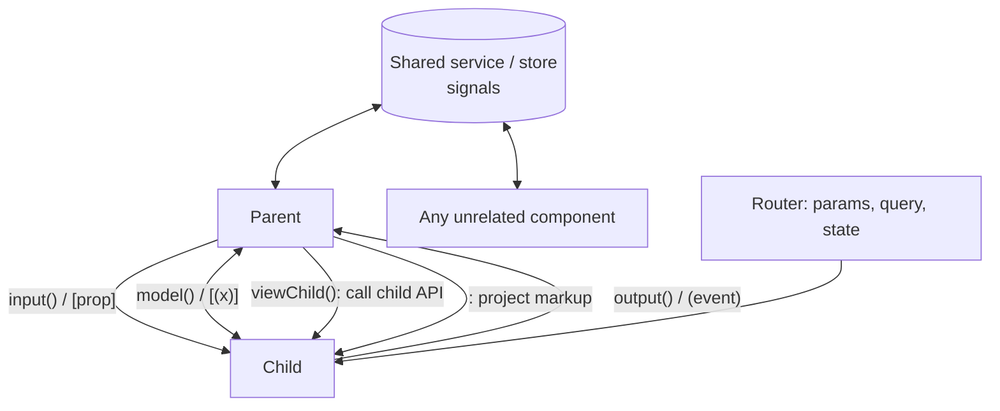
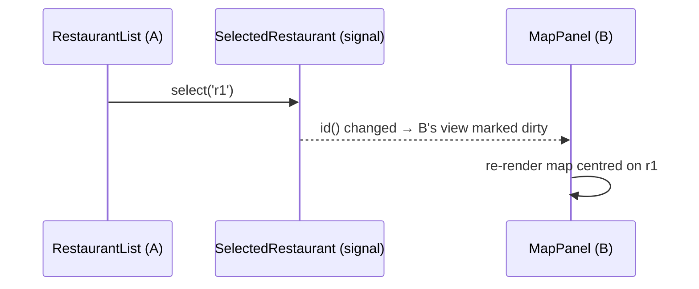

# Component Communication



| Pattern | Use when |
|---|---|
| `input()` / `output()` | direct parent ↔ child |
| `model()` | two-way state such as toggles, steppers, custom inputs |
| `viewChild()` | parent must call a child method (`focus()`, `open()`) |
| Content projection | the parent owns the markup, the child owns the layout |
| Service with signals | siblings, distant components, feature-wide state |
| Router | state that belongs in the URL (filters, ids, tabs) |

## 1. Input + output (cart stepper)

```typescript
@Component({
  selector: 'app-stepper',
  template: `
    <button (click)="changed.emit(qty() - 1)" [disabled]="qty() === 0">−</button>
    <span>{{ qty() }}</span>
    <button (click)="changed.emit(qty() + 1)">+</button>`,
})
export class Stepper {
  readonly qty = input.required<number>();
  readonly changed = output<number>();
}

@Component({
  imports: [Stepper],
  template: `<app-stepper [qty]="qty()" (changed)="qty.set($event)" /> Total: {{ qty() * 120 }}`,
})
export class Parent { protected readonly qty = signal(1); }
```

!!! output "Output after clicking + twice"
    ```text
    − 3 +  Total: 360
    ```

## 2. Content projection

```typescript
@Component({
  selector: 'app-panel',
  template: `
    <header><ng-content select="[panel-title]">Default title</ng-content></header>
    <section><ng-content /></section>
    <footer><ng-content select="app-panel-actions" /></footer>`,
})
export class Panel {}
```

```html
<app-panel>
  <h3 panel-title>Order #1001</h3>
  <p>2 × Butter Chicken</p>
  <app-panel-actions><button>Reorder</button></app-panel-actions>
</app-panel>
```

!!! info "Fallback content (v18+)"
    The text inside `<ng-content>` ("Default title") renders when nothing matches the selector.

## 3. Shared signal service (siblings)

```typescript
@Injectable({ providedIn: 'root' })
export class SelectedRestaurant {
  private readonly _id = signal<string | null>(null);
  readonly id = this._id.asReadonly();
  select(id: string) { this._id.set(id); }
}
// Component A: inject(SelectedRestaurant).select('r1')
// Component B: protected sel = inject(SelectedRestaurant); template: {{ sel.id() }}
```



## 4. Parent calls child

```typescript
@Component({ template: `<app-search #s /> <button (click)="s.focus()">Focus</button>` })
// or
readonly search = viewChild.required(SearchBox);
ngAfterViewInit() { this.search().focus(); }
```

## Interview corner

??? question "How do siblings communicate without a shared parent?"
    Through a **service holding signals** (or a Subject/BehaviorSubject in RxJS code), scoped where both can reach it.
    That's root, a route or a common ancestor component. Avoid `EventEmitter` in services, because it's meant for `@Output` only.

??? question "Why shouldn't a child mutate an object it received via input?"
    It breaks one-way data flow and OnPush. The parent's reference doesn't change, so other OnPush consumers
    don't update, and it's hard to debug who changed what. Emit an event and let the owner create a new object.
