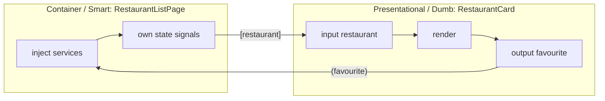

# Components

A component = **TypeScript class + template + styles + metadata**. It controls a patch of the screen (a *view*).

## Anatomy

```typescript title="greeting.ts"
import { Component, computed, input, output, model, signal, ChangeDetectionStrategy } from '@angular/core';

@Component({
  selector: 'app-greeting',                 // <app-greeting> (element), [appGreeting] (attribute), .x (class)
  imports: [],                              // template dependencies (components, directives, pipes)
  template: `
    <h2>Hello, {{ name() }}!</h2>
    <p>You clicked {{ clicks() }} times ({{ parity() }})</p>
    <button (click)="click()">Click</button>
    <input [value]="nickname()" (input)="nickname.set($any($event.target).value)" />
  `,
  styles: `h2 { color: crimson; }`,         // string or array (v17+), or styleUrl
  host: { class: 'greeting', '[attr.aria-busy]': 'busy()', '(keydown.escape)': 'reset()' },
  changeDetection: ChangeDetectionStrategy.OnPush, // default in v22, shown for clarity
})
export class Greeting {
  readonly name = input.required<string>();            // parent → child
  readonly greeted = output<string>();                 // child → parent
  readonly nickname = model('');                       // two-way [(nickname)]
  protected readonly clicks = signal(0);               // local state
  protected readonly parity = computed(() => (this.clicks() % 2 ? 'odd' : 'even'));
  protected readonly busy = signal(false);

  click() {
    this.clicks.update((c) => c + 1);
    this.greeted.emit(this.name());
  }
  reset() { this.clicks.set(0); }
}
```

```html title="parent template"
<app-greeting name="Asha" [(nickname)]="nick" (greeted)="log($event)" />
```

!!! output "Output (after 3 clicks)"
    ```text
    Hello, Asha!
    You clicked 3 times (odd)
    console: Asha  Asha  Asha
    ```

## `@Component` metadata reference

| Property | Purpose |
|---|---|
| `selector` | CSS selector that instantiates it |
| `template` / `templateUrl` | Inline or external HTML |
| `styles` / `styleUrl` / `styleUrls` | Component-scoped CSS |
| `imports` | Standalone deps used in the template |
| `providers` | Services scoped to this component and its children (element injector) |
| `viewProviders` | Like `providers`, but hidden from projected content |
| `changeDetection` | `OnPush` (default v22) or `Eager` |
| `encapsulation` | `Emulated` (default), `ShadowDom`, `None` |
| `host` | Host bindings and listeners (preferred over `@HostBinding`/`@HostListener`) |
| `hostDirectives` | Compose directives onto the host ([Directives](directives.md#host-directives)) |
| `exportAs` | Name for template refs: `#c="greeting"` |
| `preserveWhitespaces` | Keep whitespace (default false) |
| `animations` | Legacy `@angular/animations` triggers |
| `standalone` | `true` by default since v19. `false` = declared in an NgModule |

## Inputs

```typescript
// Signal inputs (v17.1+, stable v19), recommended
readonly size = input<'sm' | 'md' | 'lg'>('md');
readonly product = input.required<Product>();
readonly disabled = input(false, { transform: booleanAttribute }); // <x disabled>
readonly width = input(0, { transform: numberAttribute, alias: 'w' });

// Decorator inputs (legacy)
@Input({ required: true }) product!: Product;
@Input({ transform: booleanAttribute }) disabled = false;
```

| | `@Input()` | `input()` |
|---|---|---|
| Read | `this.product` | `this.product()` |
| React to change | `ngOnChanges` / setter | `computed()` / `effect()` |
| Writable by child | yes (anti-pattern) | **no** (read-only signal) |
| Required | `{ required: true }` + `!` | `input.required<T>()`, so no `!` |

## Outputs

```typescript
readonly added = output<CartLine>();           // v17.3+
readonly closed = output<void>({ alias: 'close' });

// Convert an observable into an output
readonly query = outputFromObservable(this.search$.pipe(debounceTime(300)));

// Legacy
@Output() added = new EventEmitter<CartLine>();
```

## `model()`: two-way binding (v17.2+)

```typescript
@Component({
  selector: 'app-qty',
  template: `<button (click)="value.update(v => v - 1)">−</button>{{ value() }}<button (click)="value.update(v => v + 1)">+</button>`,
})
export class Qty { readonly value = model(1); }
```

```html
<app-qty [(value)]="qty" />          <!-- qty can be a signal or a plain field -->
<p>Parent sees {{ qty() }}</p>
```

!!! output "Output (after two + clicks)"
    ```text
    − 3 +
    Parent sees 3
    ```

## View & content queries

```typescript
// Signal queries (stable v19)
readonly input = viewChild.required<ElementRef<HTMLInputElement>>('search');
readonly cards = viewChildren(RestaurantCard);
readonly tabs  = contentChildren(Tab, { descendants: true });
readonly header = contentChild(TemplateRef);

focus() { this.input().nativeElement.focus(); }

// Legacy
@ViewChild('search', { static: true }) input!: ElementRef<HTMLInputElement>;
@ContentChildren(Tab) tabs!: QueryList<Tab>;
```

## Dynamic components

```typescript
// v20+: bindings can be passed at creation time
const ref = this.vcr.createComponent(Toast, {
  bindings: [inputBinding('message', () => 'Saved!'), outputBinding('closed', () => ref.destroy())],
});

// Template-driven
// <ng-container *ngComponentOutlet="widget(); inputs: { data: data() }" />
```

## Smart vs presentational components



**Rule of thumb:** presentational components have **no injected services** (except maybe UI-only ones), are trivially
testable, and are reusable in Storybook. Smart components orchestrate, so keep them thin by delegating to stores and facades.

## Interview corner

??? question "What's the difference between `input()` and `@Input()`, and can I write to an input signal?"
    `input()` returns a read-only `InputSignal`, so you **cannot** `set` it. That forces one-way data flow.
    Use `model()` for two-way, or `linkedSignal(() => this.input())` for local, resettable state derived from an input.

??? question "`viewChild` is undefined in the constructor. Why?"
    The view doesn't exist yet. Signal queries simply return `undefined` until the view is created (they're reactive), and `.required` throws if read too early.
    Read them in `afterNextRender`, `ngAfterViewInit`, a `computed`, or an `effect`.

??? question "When would you use `viewProviders` instead of `providers`?"
    When the service should be visible to the component's own view but **not** to content projected into it
    (`<ng-content>`). This stops projected third-party components from accidentally picking up your private service.
