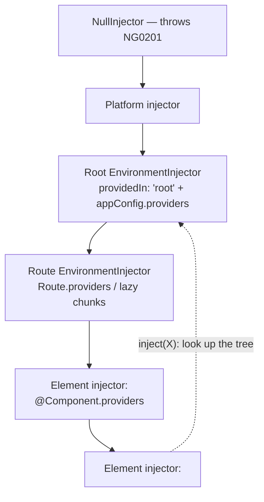
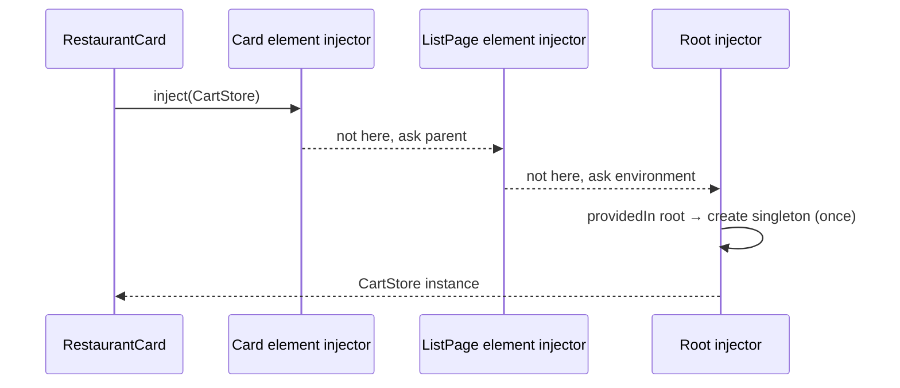

# Dependency Injection

DI is the way Angular **creates and supplies objects** (services, config, functions) to the classes that need them.
You declare *what* you need, and the injector decides *how* to create it and *which* instance to give you.

## `inject()` vs constructor injection

```typescript
@Injectable({ providedIn: 'root' })
export class RestaurantApi {
  private readonly http = inject(HttpClient);          // ✅ modern (works in fields, functions, guards)
  private readonly env = inject(APP_ENV);
}

// Legacy (still valid)
constructor(private http: HttpClient, @Inject(APP_ENV) private env: AppEnvironment) {}
```

`inject()` only works in an **injection context**: field initialisers, constructors, factory functions,
`provideAppInitializer`, functional guards, resolvers and interceptors, or inside `runInInjectionContext(injector, fn)`.

## Provider recipes

```typescript
providers: [
  RestaurantApi,                                                    // useClass shorthand
  { provide: Logger, useClass: environment.production ? RemoteLogger : ConsoleLogger },
  { provide: APP_ENV, useValue: environment },
  { provide: Clock, useFactory: () => (inject(APP_ENV).name === 'qa' ? new FakeClock() : new SystemClock()) },
  { provide: NewApi, useExisting: OldApi },                          // alias, same instance
  { provide: HTTP_INTERCEPTORS, useClass: LegacyInterceptor, multi: true }, // multi-provider (array)
]
```

## Injection tokens

```typescript title="core/config.ts (food app)"
--8<-- "src/app/core/config.ts"
```

## The injector hierarchy



**Resolution:** start at the requesting element's injector, walk **up the element tree**, then up the
**environment injectors**, and throw `NG0201: No provider for X` if nothing is found.



## Resolution modifiers

```typescript
inject(Logger, { optional: true })   // null instead of throwing
inject(ParentMenu, { skipSelf: true }) // start from the parent injector
inject(Theme, { self: true })        // only this element injector
inject(Config, { host: true })       // stop at the host component
```

## Scoping patterns

| Scope | How | Typical use |
|---|---|---|
| App singleton | `@Injectable({ providedIn: 'root' })` | API clients, AuthService, global stores |
| Lazy-route scope | `{ path: 'admin', providers: [AdminStore], loadChildren }` | Feature store that lives while the feature is loaded |
| Component scope | `@Component({ providers: [WizardStore] })` | One instance **per component instance** (e.g. each open wizard) |
| Platform | `providedIn: 'platform'` | Shared across multiple apps on one page (rare) |

```typescript
// One store per <app-checkout-wizard>; destroyed with it
@Component({ selector: 'app-checkout-wizard', providers: [WizardStore], … })
```

## Interview corner

??? question "Why is `providedIn: 'root'` preferred over listing in `providers`?"
    It's **tree-shakable**: if nothing injects the service, it isn't bundled. It's also lazily instantiated, and
    it's a singleton by default.

??? question "Two lazy routes both `inject(FooService)` and Foo is `providedIn: 'root'`. Same instance?"
    Yes. Root services are singletons for the whole app. If Foo were listed in each **route's** `providers`, each lazy
    route would get its own instance (one per route environment injector).

??? question "What's `multi: true`?"
    It turns the token into an **array**: every provider for that token contributes an item. Examples are `HTTP_INTERCEPTORS`
    (legacy), `NG_VALIDATORS` and `ENVIRONMENT_INITIALIZER`.

??? question "How would you swap a real service for a fake in tests?"
    `TestBed.configureTestingModule({ providers: [{ provide: AuthService, useValue: fakeAuth }] })`. The food-app
    guard tests do exactly this ([Unit testing](../testing/unit-testing.md)).
