# Forms

Angular has **three** form APIs. Pick one per form, and prefer one per codebase.

| | Template-driven | Reactive (typed) | **Signal Forms** (stable v22) |
|---|---|---|---|
| Import | `FormsModule` | `ReactiveFormsModule` | `@angular/forms/signals` |
| Source of truth | template (`ngModel`) | `FormGroup` in class | a `signal<Model>` |
| Validation | directives (`required`) | `Validators.*` functions | schema fns: `required(p.x)` |
| Async/observable | `valueChanges` | `valueChanges`, `events` | signals (`value()`, `valid()`) |
| Best for | tiny forms | complex/dynamic forms, existing apps | new code, zoneless apps |

## 1. Template-driven

```typescript
@Component({
  imports: [FormsModule],
  template: `
    <form #f="ngForm" (ngSubmit)="save(f.value)">
      <input name="email" [(ngModel)]="email" required email #e="ngModel" />
      @if (e.invalid && e.touched) { <small>Invalid email</small> }
      <button [disabled]="f.invalid">Save</button>
    </form>`,
})
export class Newsletter { email = ''; save(v: { email: string }) { console.log(v); } }
```

!!! output "Output"
    ```text
    { email: 'asha@food.dev' }
    ```

## 2. Reactive, strictly typed (v14+)

From the food app's checkout:

```typescript title="features/checkout/checkout.page.ts (excerpt)"
protected readonly form = this.fb.group({                 // NonNullableFormBuilder
  address: this.fb.group({
    line1: ['', Validators.required],
    city: ['', Validators.required],
    pincode: ['', [Validators.required, pincodeValidator]],
  }),
  paymentMethod: this.fb.control<'UPI' | 'CARD' | 'COD'>('UPI', Validators.required),
});
// form.getRawValue() is typed: { address: { line1: string; city: string; pincode: string }, paymentMethod: 'UPI'|'CARD'|'COD' }
```

```typescript title="features/checkout/pincode.validator.ts"
--8<-- "src/app/features/checkout/pincode.validator.ts"
```

### Dynamic `FormArray`

```typescript
readonly form = this.fb.group({ phones: this.fb.array([this.fb.control('')]) });
get phones() { return this.form.controls.phones; }
add() { this.phones.push(this.fb.control('', Validators.pattern(/^\d{10}$/))); }
```

```html
<div formArrayName="phones">
  @for (c of phones.controls; track c; let i = $index) {
    <input [formControlName]="i" /> <button (click)="phones.removeAt(i)">✕</button>
  }
</div>
```

### Async validator

```typescript
export const emailTaken = (api: UserApi): AsyncValidatorFn => (c) =>
  timer(400).pipe(switchMap(() => api.exists(c.value)), map((taken) => (taken ? { taken: true } : null)));

email = new FormControl('', { validators: [Validators.email], asyncValidators: [emailTaken(inject(UserApi))], updateOn: 'blur' });
```

### Cross-field validator

```typescript
const passwordsMatch: ValidatorFn = (g) =>
  g.get('password')?.value === g.get('confirm')?.value ? null : { mismatch: true };
this.fb.group({ password: [''], confirm: [''] }, { validators: passwordsMatch });
```

### Unified events (v18+)

```typescript
this.form.events.pipe(filter((e) => e instanceof FormSubmittedEvent)).subscribe(() => track('submit'));
```

## 3. Signal Forms (stable in v22)

A complete, tested example from the food app, a "Rate your order" form:

```typescript title="features/orders/order-feedback.ts"
--8<-- "src/app/features/orders/order-feedback.ts"
```

!!! output "Behaviour (verified by `order-feedback.spec.ts`)"
    ```text
    rating = 7                     → "Maximum 5 stars", button disabled
    rating = 1, comment = ""       → "Please tell us what went wrong (10+ chars)"
    rating = 1, comment = "Food arrived cold" → valid
    submit with comment "Great!"   → sent.emit({ rating: 5, comment: 'Great!', tip: 0 })
    ```



```mermaid
sequenceDiagram
    participant UI as <input [formField]>
    participant FF as FormField directive
    participant M as model signal
    participant V as schema (validators)
    participant T as template
    UI->>FF: input event "1"
    FF->>M: f.rating().value.set(1)
    M->>V: recompute validity (computed)
    V-->>T: f.comment().errors() = [{kind:'explain'}]
    T-->>UI: show message, disable submit
```

Other schema rules: `email`, `pattern`, `minLength`, `disabled(p.x, () => cond)`, `hidden`, `readonly`,
`debounce(p.q, 300)`, `applyEach(p.items, itemSchema)`, `applyWhen`, `validateAsync`, `validateHttp`,
`validateStandardSchema` (Zod and Valibot).

## 4. Custom form control (`ControlValueAccessor`)

```typescript
@Component({
  selector: 'app-star-rating',
  template: `@for (s of [1,2,3,4,5]; track s) {
    <button type="button" (click)="select(s)" [class.on]="s <= value()" [disabled]="disabled()">★</button> }`,
  providers: [{ provide: NG_VALUE_ACCESSOR, useExisting: StarRating, multi: true }],
})
export class StarRating implements ControlValueAccessor {
  protected value = signal(0);
  protected disabled = signal(false);
  private onChange: (v: number) => void = () => {};
  private onTouched: () => void = () => {};
  writeValue(v: number) { this.value.set(v ?? 0); }
  registerOnChange(fn: (v: number) => void) { this.onChange = fn; }
  registerOnTouched(fn: () => void) { this.onTouched = fn; }
  setDisabledState(d: boolean) { this.disabled.set(d); }
  select(s: number) { this.value.set(s); this.onChange(s); this.onTouched(); }
}
// <app-star-rating formControlName="rating" />
```

With Signal Forms, a custom control just exposes `value = model()` and works with `[formField]` without a CVA.

## Interview corner

??? question "`getRawValue()` vs `value`?"
    `value` **excludes disabled controls**. `getRawValue()` includes them. Typed forms make both strongly typed.

??? question "`updateOn: 'blur'`: why?"
    It runs validation and updates the value only on blur (or `'submit'`), which suits expensive async validators.

??? question "Why `NonNullableFormBuilder`?"
    Plain `FormControl('')` is typed `string | null`, because `reset()` sets null. Non-nullable controls reset to their
    initial value, so the type is just `string`.

??? question "Migrating Reactive → Signal Forms?"
    Do it incrementally. `@angular/forms/signals/compat` provides `compatForm` and `SignalFormControl` for interop.
    Start with new or leaf forms. Don't rewrite large stable forms just for fashion.
