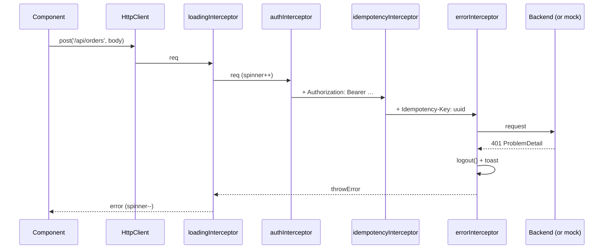

# HTTP Client

## Setup

```typescript
provideHttpClient(
  withInterceptors([authInterceptor, errorInterceptor]),  // functional interceptors
  withFetch(),               // Fetch backend (default in v22; explicit here for older versions)
  withXsrfConfiguration({ cookieName: 'XSRF-TOKEN', headerName: 'X-XSRF-TOKEN' }),
  // withXhr()               // v22: opt back into XHR (upload progress events)
  // withInterceptorsFromDi() // keep legacy class-based HTTP_INTERCEPTORS working
)
```

## A data-access service

```typescript title="core/api/restaurant-api.ts (food app)"
--8<-- "src/app/core/api/restaurant-api.ts"
```

## Calling patterns

=== "Observable + toSignal"

    ```typescript
    protected readonly orders = toSignal(inject(OrderApi).myOrders(), { initialValue: [] });
    ```

=== "httpResource (signals, stable v22)"

    ```typescript
    readonly id = input.required<string>();
    protected readonly menu = httpResource<MenuItem[]>(() => `/api/restaurants/${this.id()}/menu`, { defaultValue: [] });
    // template: @if (menu.isLoading()) {…}  @for (m of menu.value(); track m.id) {…}  menu.error()  menu.reload()
    ```

=== "resource (any async loader)"

    ```typescript
    readonly weather = resource({
      params: () => ({ city: this.city() }),
      loader: async ({ params, abortSignal }) =>
        (await fetch(`/api/weather?c=${params.city}`, { signal: abortSignal })).json(),
    });
    ```

=== "Search with switchMap"

    ```typescript
    results = toSignal(toObservable(this.q).pipe(
      debounceTime(300), distinctUntilChanged(),
      switchMap((q) => this.api.search({ q }).pipe(catchError(() => of([])))),
    ), { initialValue: [] });
    ```

### Resource states

```text
idle → loading → resolved          (value() has data)
                ↘ error            (error() has HttpErrorResponse)
resolved → reloading → resolved    (reload())
local                              (value.set(...) locally)
```

## Interceptors

```typescript title="core/http/auth.interceptor.ts"
--8<-- "src/app/core/http/auth.interceptor.ts"
```

```typescript title="core/http/error.interceptor.ts"
--8<-- "src/app/core/http/error.interceptor.ts"
```



**Order matters:** the request flows **top to bottom** through `withInterceptors([...])` and the response flows **bottom to top**.

### Other interceptor recipes

```typescript
// Per-request metadata via HttpContext
export const SKIP_LOADER = new HttpContextToken<boolean>(() => false);
http.get(url, { context: new HttpContext().set(SKIP_LOADER, true) });
// in the interceptor: if (req.context.get(SKIP_LOADER)) return next(req);

// Caching GETs
const cache = new Map<string, HttpResponse<unknown>>();
export const cacheInterceptor: HttpInterceptorFn = (req, next) => {
  if (req.method !== 'GET') return next(req);
  const hit = cache.get(req.urlWithParams);
  return hit ? of(hit.clone()) : next(req).pipe(tap((e) => e instanceof HttpResponse && cache.set(req.urlWithParams, e)));
};
```

## Other HttpClient features

```typescript
http.get<Blob>('/api/invoice/1', { responseType: 'blob' });
http.get('/api/x', { observe: 'response' }).subscribe((r) => r.headers.get('ETag'));
http.post('/api/upload', formData, { reportProgress: true, observe: 'events' }); // needs withXhr() in v22
http.get('/api/x', { params: { page: 2, size: 20 }, headers: { 'Accept-Language': 'hi' } });
http.get('/api/x', { transferCache: true });  // SSR: reuse server response on hydration
```

## Interview corner

??? question "How do you cancel an in-flight HTTP request?"
    Unsubscribe. `switchMap` does it automatically when a new value arrives, and `takeUntilDestroyed` does it on destroy.
    `httpResource` and `resource` abort when their params change (`abortSignal`).

??? question "Where do you handle errors: interceptor or component?"
    **Both, for different things.** The interceptor handles cross-cutting concerns (401 → logout, retry 5xx, toast,
    logging). The component handles UX specific to that screen (inline message, fallback data) with `catchError`
    or `resource.error()`.

??? question "Why are HttpClient observables 'cold'?"
    Nothing is sent until you subscribe, and **each subscription sends a new request**. Two `async` pipes on the same
    observable means two calls. Use `shareReplay({ bufferSize: 1, refCount: true })` or convert once to a signal.
