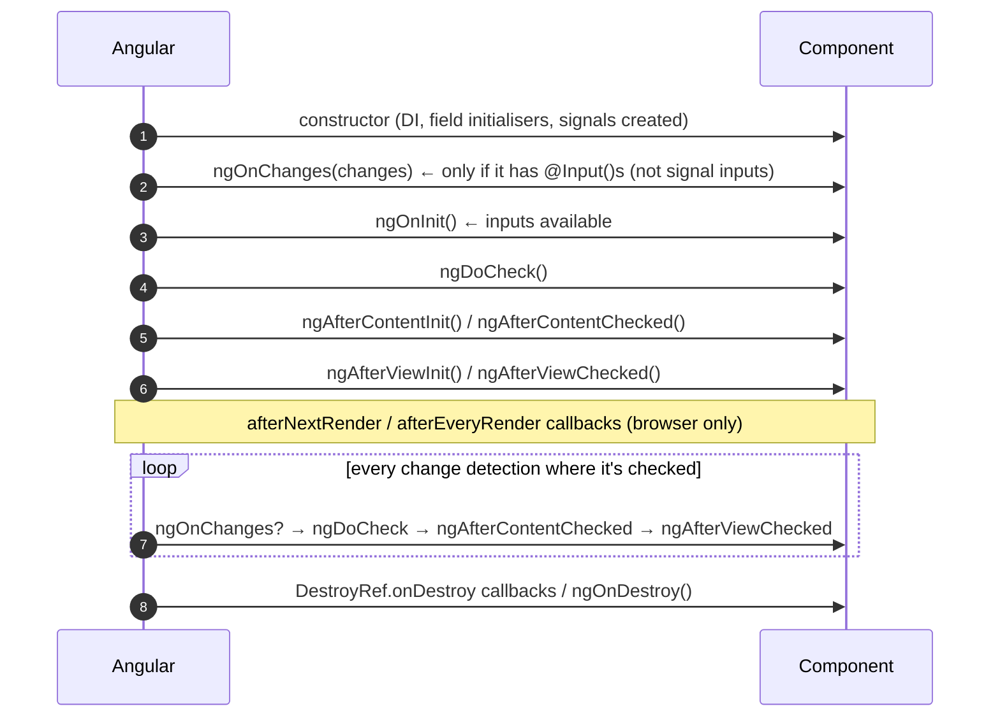

# Lifecycle Hooks



## Demo with logged output

```typescript
@Component({ selector: 'app-life', template: `<p>{{ name() }}</p><ng-content />` })
export class Life implements OnChanges, OnInit, AfterContentInit, AfterViewInit, OnDestroy {
  @Input() legacy = '';
  readonly name = input('x');
  constructor() {
    console.log('1 constructor, name() =', 'not safe to read inputs yet');
    afterNextRender(() => console.log('7 afterNextRender: DOM is painted, measure here'));
    inject(DestroyRef).onDestroy(() => console.log('9 DestroyRef.onDestroy'));
  }
  ngOnChanges(c: SimpleChanges) { console.log('2 ngOnChanges', Object.keys(c)); }
  ngOnInit() { console.log('3 ngOnInit, name() =', this.name()); }
  ngAfterContentInit() { console.log('4 ngAfterContentInit'); }
  ngAfterViewInit() { console.log('5 ngAfterViewInit'); }
  ngOnDestroy() { console.log('8 ngOnDestroy'); }
}
```

!!! output "Output for `<app-life legacy='a' name='Asha' />`, then removed"
    ```text
    1 constructor, name() = not safe to read inputs yet
    2 ngOnChanges [ 'legacy', 'name' ]
    3 ngOnInit, name() = Asha
    4 ngAfterContentInit
    5 ngAfterViewInit
    7 afterNextRender: DOM is painted, measure here
    8 ngOnDestroy
    9 DestroyRef.onDestroy
    ```

## When to use what

| Hook | Use for | Avoid |
|---|---|---|
| `constructor` | `inject()`, creating signals, `effect()` | reading inputs, DOM |
| `ngOnChanges` | reacting to `@Input` changes (legacy) | with signal inputs, use `computed` instead |
| `ngOnInit` | kicking off work that needs inputs (e.g. `track(this.id())`) | heavy sync work |
| `ngDoCheck` | custom dirty-checking (rare) | anything expensive, since it runs every CD |
| `ngAfterViewInit` | view queries, 3rd-party widget init | changing bound state (causes NG0100) |
| `afterNextRender` (v16.2+) | one-time DOM measuring, chart libs, focus | SSR-unsafe code elsewhere |
| `afterEveryRender` (v20, was `afterRender`) | sync with DOM after every render | — |
| `afterRenderEffect` (v19+) | signal-driven DOM work, phased (`earlyRead`, `write`, `mixedReadWrite`, `read`) | — |
| `ngOnDestroy` / `DestroyRef` | cleanup: timers, sockets, 3rd-party instances | — |

## Cleanup patterns

```typescript
// 1. takeUntilDestroyed (rxjs-interop): best for subscriptions
this.api.track(this.id()).pipe(takeUntilDestroyed(this.destroyRef)).subscribe(...)

// 2. DestroyRef: anywhere in an injection context
inject(DestroyRef).onDestroy(() => socket.close());

// 3. effect cleanup
effect((onCleanup) => {
  const t = setInterval(() => this.tick(), 1000);
  onCleanup(() => clearInterval(t));
});
```

## Interview corner

??? question "Why do I get `NG0100: ExpressionChangedAfterItHasBeenCheckedError`?"
    In dev mode Angular runs a second check pass. If a bound value changed during the first pass (typically set in
    `ngAfterViewInit` or a getter returning a new object every time), you get NG0100. Fix it by deriving state with
    `computed`, moving the logic earlier (`ngOnInit`), or using signals so the change schedules a new render instead.

??? question "`ngOnInit` vs constructor?"
    Constructor = DI and wiring, with no inputs yet. `ngOnInit` = inputs are set, so start data loading here.
    With signal inputs + `computed`/`resource` you often need neither.
