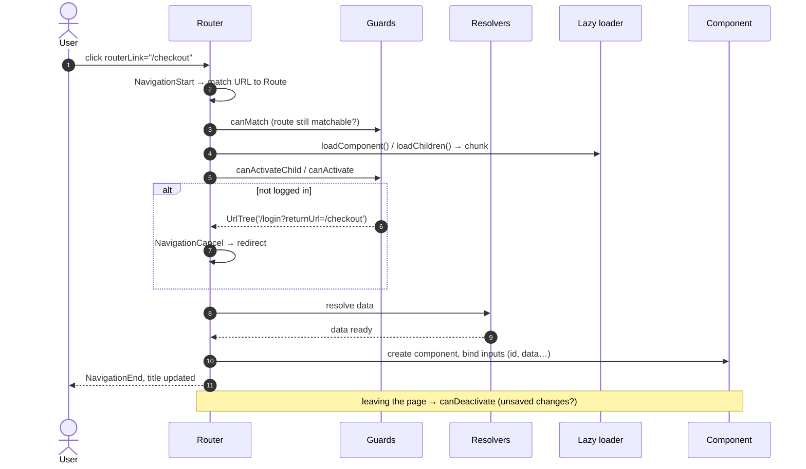

# Routing & Navigation

## Route configuration (food app)

```typescript title="app.routes.ts"
--8<-- "src/app/app.routes.ts"
```

```typescript title="app.config.ts (router features)"
provideRouter(
  routes,
  withComponentInputBinding(),      // :id, ?q=, data, resolve → component input()s
  withViewTransitions(),            // View Transitions API animations
  withInMemoryScrolling({ scrollPositionRestoration: 'top', anchorScrolling: 'enabled' }),
  withPreloading(PreloadAllModules),// or a custom strategy
  withRouterConfig({ paramsInheritanceStrategy: 'always' }),
  withHashLocation(),               // /#/path, only if the server can't do SPA fallback
  withDebugTracing(),               // log router events (dev only)
)
```

## Navigation lifecycle



## Reading params

```typescript
// ✅ v16+: route params as inputs (needs withComponentInputBinding)
export class RestaurantMenuPage {
  readonly id = input.required<string>();          // /restaurants/:id
  readonly tab = input<string>();                   // ?tab=reviews
}

// Classic
private route = inject(ActivatedRoute);
id = toSignal(this.route.paramMap.pipe(map((p) => p.get('id')!)));
snapshotId = this.route.snapshot.paramMap.get('id');
```

## Navigating in code

```typescript
router.navigate(['/restaurants', r.id], { queryParams: { tab: 'menu' }, queryParamsHandling: 'merge' });
router.navigateByUrl('/orders/o1001', { replaceUrl: true });
router.navigate(['../cart'], { relativeTo: this.route, state: { from: 'menu' } });
```

```html
<a [routerLink]="['/restaurants', r.id]" [queryParams]="{ tab: 'menu' }" routerLinkActive="active"
   [routerLinkActiveOptions]="{ exact: true }" ariaCurrentWhenActive="page">{{ r.name }}</a>
```

## Guards (functional, v15+)

```typescript title="core/auth/auth.guards.ts (food app)"
--8<-- "src/app/core/auth/auth.guards.ts"
```

| Guard | Runs | Typical use |
|---|---|---|
| `canMatch` | before matching & **before downloading** lazy code | role-based features, A/B routes |
| `canActivate` | before activating | authentication |
| `canActivateChild` | before each child | section-wide checks |
| `canDeactivate` | before leaving | unsaved-changes dialogs |
| `resolve` | after guards | pre-fetch page data |

!!! note "v22: `CanMatchFn` receives a third argument"
    `(route, segments, currentSnapshot)`. The `can-match-snapshot-required` migration updates call sites.

## Resolvers

```typescript
export const restaurantResolver: ResolveFn<Restaurant> = (route) =>
  inject(RestaurantApi).get(route.paramMap.get('id')!);

{ path: 'restaurants/:id', resolve: { restaurant: restaurantResolver }, loadComponent: … }
// component: readonly restaurant = input.required<Restaurant>();
```

!!! tip "Resolver or `resource`?"
    Resolvers block navigation, so the user sees nothing until data arrives. For most pages, navigate immediately and
    show a skeleton with `httpResource()` (as the food app's menu page does). Use resolvers when the page is
    meaningless without the data, or for SEO/SSR.

## Lazy loading & preloading

```typescript
{ path: 'admin', loadChildren: () => import('./features/admin/admin.routes').then((m) => m.ADMIN_ROUTES) }
{ path: 'cart', loadComponent: () => import('./features/cart/cart.page').then((m) => m.CartPage) }
// default export shorthand:  loadComponent: () => import('./cart.page')
```

Custom preloading: preload only routes flagged `data: { preload: true }`:

```typescript
@Injectable({ providedIn: 'root' })
export class FlagPreloading implements PreloadingStrategy {
  preload(route: Route, load: () => Observable<unknown>) {
    return route.data?.['preload'] ? load() : of(null);
  }
}
```

## Other features

```typescript
{ path: '', redirectTo: 'restaurants', pathMatch: 'full' }
{ path: 'old/:id', redirectTo: ({ params }) => `/restaurants/${params['id']}` }  // v18 function redirect
{ path: 'chat', outlet: 'side', component: ChatPanel }                         // named outlet
// <router-outlet name="side" />  and  routerLink="[{ outlets: { side: ['chat'] } }]"
{ path: 'menu', title: menuTitleResolver }                                     // dynamic title
{ path: '**', component: NotFoundPage }                                        // wildcard last!
```

## Interview corner

??? question "canActivate vs canMatch for admin pages?"
    `canActivate` runs **after** the lazy chunk is downloaded, so a customer could still fetch admin JS. `canMatch` runs
    first, and if it returns false the router keeps matching other routes and **never downloads** the chunk.
    Either way the backend must enforce permissions. Guards are UX, not security.

??? question "How do you keep filter state across reloads and make it shareable?"
    Put it in **query params** (`?q=pizza&veg=true`), read it via input binding, and write it with
    `router.navigate([], { queryParams, queryParamsHandling: 'merge', replaceUrl: true })`.

??? question "Why do deep links 404 in production?"
    The web server looks for a file at `/orders/o1001`. Configure the SPA fallback to `index.html`
    (`try_files $uri /index.html` in Nginx; see [Docker & Nginx](../deploy/docker-nginx.md)).
