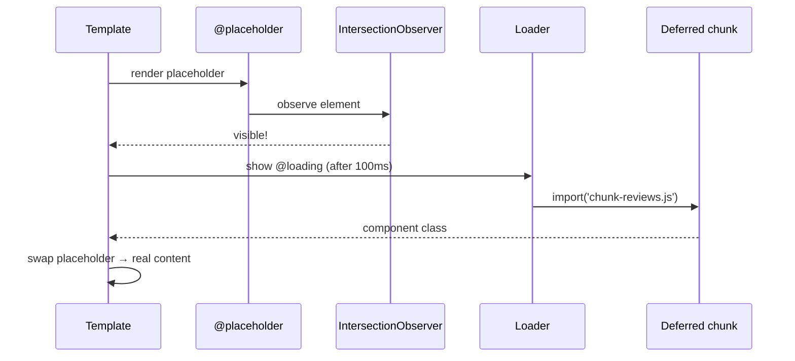

# Templates & Control Flow

## Binding syntax at a glance

| Syntax | Direction | Example |
|---|---|---|
| `{{ expr }}` | class → DOM (text) | `{{ user().name }}` |
| `[prop]="expr"` | class → DOM property | `[disabled]="busy()"` |
| `[attr.x]` | → attribute | `[attr.aria-label]="label"` |
| `[class.x]` / `[class]` | → CSS class | `[class.active]="isActive()"` |
| `[style.x]` / `[style.width.px]` | → inline style | `[style.width.px]="w()"` |
| `(event)="handler($event)"` | DOM → class | `(click)="save()"`, `(keyup.enter)="search()"` |
| `[(ngModel)]` / `[(value)]` | two-way | `[(value)]="qty"` (banana in a box) |
| `#ref` | template reference | `<input #q /> {{ q.value }}` |

```html
<input #q (keyup.enter)="search(q.value)" [placeholder]="hint()" />
<button [disabled]="q.value.length < 2" (click)="search(q.value)">Go</button>
<div [class]="{ card: true, selected: selected() }" [style.--accent]="color()"></div>
```

!!! tip "Template expression rules"
    No assignments (except in event handlers), no `new`, no globals like `window` or `console`. Keep logic in the class.
    v20+ adds `**`, `in`, `void`, `typeof` and tagged template literals. v21 adds regex literals.

## Built-in control flow (v17+)

=== "@if"

    ```html
    @if (user(); as u) {
      <p>Welcome {{ u.name }}</p>
    } @else if (loading()) {
      <spinner />
    } @else {
      <a routerLink="/login">Sign in</a>
    }
    ```

=== "@for"

    ```html
    <ul>
      @for (item of items(); track item.id; let i = $index, last = $last) {
        <li [class.last]="last">{{ i + 1 }}. {{ item.name }}</li>
      } @empty {
        <li>No items</li>
      }
    </ul>
    ```
    Context variables: `$index`, `$count`, `$first`, `$last`, `$even`, `$odd`.
    `track` is **mandatory**. Use a stable id, or `$index` for static lists.

=== "@switch"

    ```html
    @switch (order().status) {
      @case ('PLACED')    { <span>📝 Placed</span> }
      @case ('DELIVERED') { <span>🎉 Delivered</span> }
      @default            { <span>{{ order().status }}</span> }
    }
    ```

=== "@let (v18.1+)"

    ```html
    @let total = cart.total();
    @let user = user$ | async;
    <p>{{ user?.name }} pays {{ total | inr }}</p>
    ```

!!! output "Output (`@for` with 3 items)"
    ```text
    1. Butter Chicken
    2. Paneer Tikka
    3. Garlic Naan
    ```

### Why `@for` beats `*ngFor`

- `track` is mandatory, so no accidental full re-renders.
- It uses a faster diffing algorithm (up to ~90% faster in benchmarks).
- `@empty` is built in, and it needs no `CommonModule` import.

## Deferrable views: `@defer` (v17+)

Lazy-load **part of a template** (components, directives and pipes inside it become a separate chunk).

```html
@defer (on viewport; prefetch on idle) {
  <app-reviews [restaurantId]="id()" />
} @placeholder (minimum 300ms) {
  <div class="skeleton"></div>
} @loading (after 100ms; minimum 500ms) {
  <spinner />
} @error {
  <p>Could not load reviews</p>
}
```

| Trigger | Fires when |
|---|---|
| `on idle` (default) | browser `requestIdleCallback` |
| `on viewport` | placeholder (or `on viewport(ref)`) enters the viewport |
| `on interaction` | click or keydown on placeholder or ref |
| `on hover` | mouseover or focusin |
| `on timer(2s)` | after a delay |
| `on immediate` | right after the non-deferred content renders |
| `when cond()` | the expression becomes truthy (one-shot) |
| `hydrate on …` | SSR incremental hydration (v19+, default-enabled v22) |

!!! warning "Gotcha (seen in the example app)"
    `on viewport`, `on interaction` and `on hover` **without a target** need a `@placeholder` block.
    Otherwise `ng build` fails with **NG8019**. Unit tests may not catch it, so always run a prod build in CI.



## `ng-template`, `ng-container`, `ngTemplateOutlet`

```html
<!-- ng-container: groups without adding a DOM element -->
<ng-container *ngTemplateOutlet="row; context: { $implicit: item, idx: 1 }" />

<!-- ng-template: a blueprint, rendered only on demand -->
<ng-template #row let-item let-i="idx">
  <tr><td>{{ i }}</td><td>{{ item.name }}</td></tr>
</ng-template>
```

**Typed templates:** add `static ngTemplateContextGuard(dir, ctx): ctx is MyCtx { return true; }` to a directive
so `let-` variables are typed.

## Legacy structural directives (deprecated v20)

| Old | New |
|---|---|
| `*ngIf="x; else y"` | `@if (x) {} @else {}` |
| `*ngFor="let i of items; trackBy: fn"` | `@for (i of items; track i.id) {}` |
| `[ngSwitch]` / `*ngSwitchCase` | `@switch` / `@case` |
| `[ngClass]` / `[ngStyle]` | `[class]` / `[style]` bindings (migration in v21) |

Run `ng g @angular/core:control-flow` to migrate automatically.

## Interview corner

??? question "Why is `track` mandatory in `@for`?"
    Without a key, Angular can't tell a moved or changed item from a new one, so it destroys and recreates DOM nodes.
    That loses focus and input state, replays animations and wastes CPU. Making `track` mandatory turns the most common
    performance bug in `*ngFor` code (a missing `trackBy`) into a compile error.

??? question "What's the difference between `@defer` and lazy routes?"
    Lazy routes split code **per URL**. `@defer` splits **within a page** (below-the-fold widgets, heavy charts, modals).
    Both create separate chunks. `@defer` only works for **standalone** dependencies that aren't referenced elsewhere in the same file.

??? question "Is a function call in a template bad?"
    With *zone-based* default change detection, `{{ total() }}` on a plain method runs on **every** CD cycle.
    With **signals** it's cheap: a signal read is a getter, and `computed` is memoised. So `{{ count() }}` is fine,
    while `{{ calculateExpensive() }}` on a plain method is still an anti-pattern. Use `computed` or a pure pipe.
