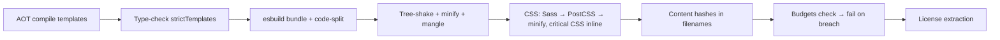

# Build Commands

## Everyday builds

```bash
ng build                                  # production (default configuration)
ng build --configuration development      # -c development
ng build -c qa                            # custom config
ng build -c production --base-href /food/ --deploy-url /food/
ng build --watch -c development           # rebuild on change
ng build --stats-json                     # bundle analysis
ng build --localize                       # one output per locale
```

!!! output "`npm run build:prod` (food app, real output)"
    ```text
    Initial chunk files | Names                |  Raw size | Estimated transfer size
    chunk-DMc4FIzv.js   | -                    | 197.82 kB |                58.08 kB
    main-M5JP63PY.js    | main                 | 190.70 kB |                46.93 kB
    styles-Q37JWNCL.css | styles               |   1.33 kB |               497 bytes
                        | Initial total        | 389.85 kB |               105.51 kB

    Lazy chunk files    | Names                |  Raw size | Estimated transfer size
    chunk-nKRiwDVa.js   | restaurant-menu-page |   4.64 kB |                 1.83 kB
    chunk-Cs6FAETo.js   | checkout-page        |   3.23 kB |                 1.46 kB
    chunk-4sOfcik1.js   | cart-page            |   3.19 kB |                 1.30 kB
    chunk-Bm8fVRYq.js   | order-tracking-page  |   2.73 kB |                 1.22 kB
    chunk-oy66JN6S.js   | login-page           |   2.50 kB |                 1.15 kB
    chunk-DNhSSafb.js   | admin-dashboard-page |   1.66 kB |               792 bytes
    chunk-TY0-jyAj.js   | orders-page          |   1.34 kB |               720 bytes

    Application bundle generation complete. [4.581 seconds]
    Output location: dist/food-delivery-app
    ```

## Output layout

```text
dist/food-delivery-app/
├── browser/                 # deploy THIS folder (CSR)
│   ├── index.html
│   ├── main-M5JP63PY.js     # content-hashed → cache forever
│   ├── chunk-*.js           # lazy routes / @defer blocks
│   ├── styles-*.css
│   └── favicon.ico          # from public/
├── server/                  # only with SSR (node server.mjs)
├── 3rdpartylicenses.txt
└── prerendered-routes.json  # only with SSG
```

## What a production build does



## Build options you'll tune

| Option | Effect |
|---|---|
| `optimization` | minify scripts and styles, inline critical CSS, inline fonts |
| `outputHashing: "all"` | cache-busting filenames |
| `sourceMap` | `true` / `{ scripts, styles, hidden, vendor }`. `hidden` = generate maps but don't reference them (upload to Sentry) |
| `namedChunks` | readable chunk names (debugging QA) |
| `budgets` | size limits (warn/error) |
| `fileReplacements` | environment swapping |
| `define` | compile-time constants: `"define": { "BUILD_SHA": "'abc123'" }` |
| `externalDependencies` | don't bundle a package |
| `allowedCommonJsDependencies` | silence CJS warnings for known libs |
| `security.autoCsp` | generate CSP hashes for inline scripts |
| `outputMode` | `static` (SSG/CSR) or `server` (SSR) |

## Serving a production build locally

```bash
npx serve -s dist/food-delivery-app/browser -l 8080      # -s = SPA fallback to index.html
# or the real thing:
docker build -t food-web . && docker run -p 8080:8080 food-web
```

## Interview corner

??? question "Why do filenames contain hashes, and why must `index.html` not be cached?"
    Hashes change whenever content changes, so JS and CSS can be cached for a year (`immutable`). `index.html`
    references the current hashes. If the browser caches it, users load old bundle names after a deploy and get
    404s or a stale app. So `index.html` gets `Cache-Control: no-cache`.

??? question "Build is slow in CI. What do you do?"
    Cache `~/.npm` and `.angular/cache` between runs, use `npm ci`, build once and reuse the artefact across jobs,
    use Nx affected or remote caching in monorepos, and avoid building per environment (runtime config).
