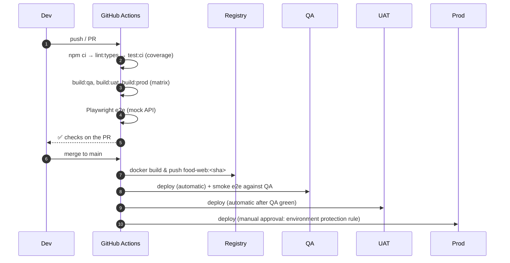

# CI/CD Pipeline

The repository ships two real workflows:

- `.github/workflows/app-ci.yml`: test, build every environment and run E2E for the food app
- `.github/workflows/docs.yml`: build this MkDocs site with `--strict` and publish it to GitHub Pages

## App pipeline

```yaml title=".github/workflows/app-ci.yml"
--8<-- ".github/workflows/app-ci.yml"
```



## Deployment stage examples

=== "Static hosting (S3 + CloudFront)"

    ```yaml
    deploy-prod:
      needs: build
      environment: production            # requires reviewers in repo settings
      runs-on: ubuntu-latest
      permissions: { id-token: write, contents: read }
      steps:
        - uses: actions/download-artifact@v4
          with: { name: dist-production, path: dist }
        - uses: aws-actions/configure-aws-credentials@v4
          with: { role-to-assume: arn:aws:iam::123456789012:role/deploy-web, aws-region: ap-south-1 }
        - run: |
            aws s3 sync dist/browser s3://food-web-prod --delete --exclude index.html \
              --cache-control "public,max-age=31536000,immutable"
            aws s3 cp dist/browser/index.html s3://food-web-prod/index.html --cache-control "no-cache"
            aws cloudfront create-invalidation --distribution-id ${{ vars.CF_DIST_ID }} --paths /index.html
    ```

=== "Container (Kubernetes / Helm)"

    ```yaml
    deploy-qa:
      needs: image
      environment: qa
      runs-on: ubuntu-latest
      steps:
        - run: helm upgrade --install food-web ./chart -n web --set image.tag=${{ github.sha }} -f values-qa.yaml --wait
    ```

=== "Firebase"

    ```bash
    npm i -g firebase-tools
    ng add @angular/fire
    ng deploy        # or: firebase deploy --only hosting:prod
    ```

## Release strategy

- **Trunk-based**, short-lived branches, every merge deployable.
- **Feature flags** (`environment.featureFlags` or a flag service) to ship dark.
- **Versioning**: `npm version minor` + git tag, injected into the build via `define: { APP_VERSION }`, and shown in the footer and Sentry releases.
- **Rollback**: redeploy the previous image tag, or the previous S3 version and invalidate.
