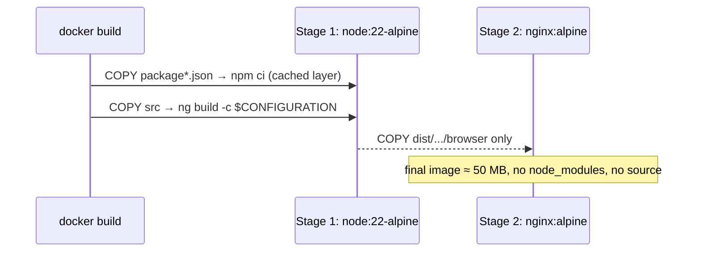

# Docker & Nginx

## Multi-stage Dockerfile (food app)

```dockerfile title="examples/food-delivery-app/Dockerfile"
--8<-- "Dockerfile"
```

```bash
docker build -t food-web:prod .                                     # production
docker build --build-arg CONFIGURATION=qa  -t food-web:qa  .
docker build --build-arg CONFIGURATION=uat -t food-web:uat .
docker run --rm -p 8080:8080 food-web:prod                          # http://localhost:8080
```



## Nginx configuration

```nginx title="examples/food-delivery-app/nginx.conf"
--8<-- "nginx.conf"
```

| Block | Why |
|---|---|
| `try_files $uri $uri/ /index.html` | **SPA fallback**: deep links like `/orders/o1001` work on refresh |
| hashed assets `expires 1y; immutable` | best caching for content-hashed files |
| `index.html` `no-cache` | users always get the latest bundle references |
| security headers | CSP, nosniff, frame denial |
| `/healthz` | Kubernetes liveness/readiness probe |

## Proxying the API through the same origin (no CORS)

```nginx
location /api/ {
  proxy_pass http://order-gateway:8080/;
  proxy_set_header Host $host;
  proxy_set_header X-Forwarded-For $proxy_add_x_forwarded_for;
  proxy_set_header X-Forwarded-Proto $scheme;
}
```

## docker-compose (local full stack)

```yaml
services:
  web:
    build: { context: ., args: { CONFIGURATION: qa } }
    ports: ["8080:8080"]
    depends_on: [api]
  api:
    image: food/api-gateway:latest
    environment: { SPRING_PROFILES_ACTIVE: qa }
```

## Kubernetes snippet

```yaml
apiVersion: apps/v1
kind: Deployment
metadata: { name: food-web }
spec:
  replicas: 3
  selector: { matchLabels: { app: food-web } }
  template:
    metadata: { labels: { app: food-web } }
    spec:
      containers:
        - name: web
          image: registry.example.com/food-web:1.4.2
          ports: [{ containerPort: 8080 }]
          readinessProbe: { httpGet: { path: /healthz, port: 8080 } }
          resources: { requests: { cpu: 50m, memory: 32Mi }, limits: { memory: 128Mi } }
```
