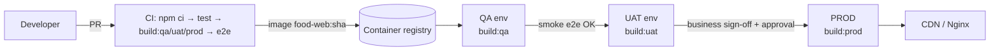

# Build & Deploy

<a class="tilt" href="environments/">🌱<b>Environments</b>dev / qa / uat / prod configs</a>
<a class="tilt" href="build/">🏗️<b>Build Commands</b>Every flag, output, optimisation</a>
<a class="tilt" href="docker-nginx/">🐳<b>Docker &amp; Nginx</b>Multi-stage image, SPA fallback, caching</a>
<a class="tilt" href="ci-cd/">🔁<b>CI/CD</b>GitHub Actions pipeline with promotion</a>
<a class="tilt" href="cloud/">☁️<b>Cloud Hosting</b>S3+CloudFront, Azure, Firebase, Vercel, K8s</a>

