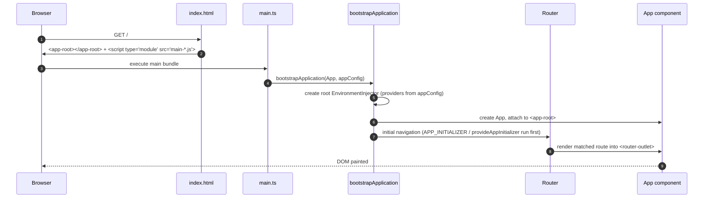

# Project Structure

## What `ng new` generates (v22)

```text
food-delivery-app/
├── angular.json            # workspace config: projects, builders, build configurations
├── package.json            # deps + npm scripts
├── package-lock.json       # exact dependency tree (commit it!)
├── tsconfig.json           # base TS config (strict) + angularCompilerOptions
├── tsconfig.app.json       # what goes into the app build (excludes *.spec.ts)
├── tsconfig.spec.json      # what goes into the unit-test build (vitest globals)
├── .editorconfig  .prettierrc  .gitignore
├── .vscode/                # recommended extensions, launch & tasks
├── public/                 # copied as-is to dist (favicon, robots.txt, images)
└── src/
    ├── index.html          # host page with <app-root>
    ├── main.ts             # bootstrapApplication(App, appConfig)
    ├── styles.scss         # global styles
    └── app/
        ├── app.ts          # root component (2025 style guide: no .component suffix)
        ├── app.html / app.scss
        ├── app.spec.ts     # Vitest + TestBed
        ├── app.config.ts   # ApplicationConfig: providers (router, http, …)
        └── app.routes.ts   # Routes array
```

!!! note "2025 file-naming style guide (v20+)"
    New projects generate `app.ts` / `class App` instead of `app.component.ts` / `class AppComponent`.
    Pick a suffix that adds meaning, like `login.page.ts`, `cart.store.ts` or `auth.guards.ts`.
    `ng new --file-name-style-guide=2016` restores the old names.

## Recommended feature-first layout (large apps)

```text
src/app/
├── core/                    # singletons, app-wide, no UI: imported once
│   ├── auth/                #   AuthService, guards, has-role logic
│   ├── http/                #   interceptors (auth, error, idempotency, loading)
│   ├── api/                 #   data-access services (one per backend resource)
│   ├── models/              #   TS interfaces/types shared by features
│   └── config.ts            #   InjectionTokens (APP_ENV, feature flags)
├── shared/                  # reusable, stateless UI building blocks
│   ├── ui/                  #   buttons, badges, toasts, dialogs
│   ├── pipes/  directives/
├── features/                # one folder per business capability, lazy-loaded
│   ├── restaurants/         #   list page, menu page, card component
│   ├── cart/                #   CartStore (signals), cart page
│   ├── checkout/ orders/ admin/ auth/
├── layout/                  # shell: header, footer, status pages
├── app.config.ts  app.routes.ts  app.ts
```

**Dependency rule:** `features → shared, core`. `shared → core (models only)`. Features never import other features
(go through `core` or the router). Enforce it with ESLint `import/no-restricted-paths` or Nx module boundaries.

## `angular.json` anatomy

```json
{
  "projects": {
    "food-delivery-app": {
      "projectType": "application",
      "sourceRoot": "src",
      "prefix": "app",
      "architect": {
        "build": {
          "builder": "@angular/build:application",      // esbuild-based (v17+)
          "options": { "browser": "src/main.ts", "tsConfig": "tsconfig.app.json", "styles": ["src/styles.scss"] },
          "configurations": {
            "production": { "budgets": [/*…*/], "outputHashing": "all", "fileReplacements": [/*…*/] },
            "qa": { /*…*/ }, "uat": { /*…*/ },
            "development": { "optimization": false, "sourceMap": true }
          },
          "defaultConfiguration": "production"
        },
        "serve": { "builder": "@angular/build:dev-server" },
        "test":  { "builder": "@angular/build:unit-test" }   // Vitest (v21+)
      }
    }
  }
}
```

## Boot sequence


