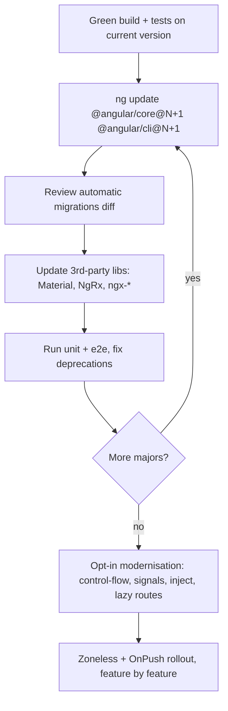

# Angular 17 → 22: What Changed

Angular ships a **major every ~6 months** (May and November). Each major gets **18 months** of support:
6 months active, then 12 months LTS. Below are the changes a senior engineer should know, release by release.

<div class="timeline3d" markdown>

**Angular 17 (Nov 2023): the "renaissance"**

- New **built-in control flow**: `@if`, `@for` (with mandatory `track`), `@switch`, `@empty`
- **Deferrable views** with `@defer (on viewport | idle | interaction | hover | timer | immediate | when cond)`, plus `@placeholder`, `@loading` and `@error`
- **Standalone by default** for `ng new`. New **esbuild + Vite** `application` builder
- `ng new --ssr` with `@angular/ssr`. Hydration is stable
- Signals `signal`/`computed` **stable**
- `withViewTransitions()`, `withFetch()` for HttpClient, new docs site **angular.dev**
- 17.1: **signal inputs** `input()`. 17.2: **`model()`** and **signal queries** `viewChild()`. 17.3: **`output()`**

**Angular 18 (May 2024)**

- **Experimental zoneless**: `provideExperimentalZonelessChangeDetection()`
- Control flow and `@defer` **stable**. **Material 3** stable
- `<ng-content>` **fallback content**
- Unified form events: `control.events` (value, status, pristine, touched, submit and reset events)
- Route `redirectTo` can be a **function**
- **Event replay** (dev preview) for SSR
- 18.1: **`@let`** template variables

**Angular 19 (Nov 2024)**

- `standalone: true` is now the **default** (no need to write it)
- **`linkedSignal`** and **`resource()` / `rxResource()`** (experimental)
- **Incremental hydration** (dev preview): `@defer (hydrate on viewport)`
- **Route-level render mode** (`RenderMode.Server | Client | Prerender`) for hybrid SSR
- HMR for styles by default, and for templates experimentally
- Signal inputs, outputs, `model` and queries **stable**. `@let` stable
- 19.2: **`httpResource()`** (experimental)

**Angular 20 (May 2025)**

- `effect`, `linkedSignal`, `toSignal`, `toObservable`, `afterRenderEffect` **stable**
- Zoneless: `provideZonelessChangeDetection()` (developer preview)
- Incremental hydration **stable**
- Template syntax: `**` exponent, the `in` operator, `void`, tagged template literals
- `*ngIf`/`*ngFor`/`*ngSwitch` **deprecated** in favour of the built-in control flow
- **New style guide**: no `.component` / `.service` suffixes in generated files
- `afterRender` renamed to **`afterEveryRender`**. `provideBrowserGlobalErrorListeners()`
- Vitest support (experimental). Karma is in maintenance

**Angular 21 (Nov 2025)**

- **Zoneless by default** for new apps (no `zone.js` in polyfills)
- **Vitest is the default test runner** (`@angular/build:unit-test`)
- **Signal Forms** (experimental): `form()`, schema validators, `@angular/forms/signals`
- **Angular Aria** (developer preview): headless accessible primitives (`@angular/aria`)
- Angular **MCP server** for AI assistants (`ng mcp`). `ng new --ai-config`
- Migrations for `NgClass → [class]` and `NgStyle → [style]`. RegExp literals in templates

**Angular 22 (May 2026): current stable (22.2)**

- **OnPush is the default** change-detection strategy. `ChangeDetectionStrategy.Eager` is the new name for the old default (`Default` is deprecated). The `ng update` migration adds `Eager` to existing components so their behaviour stays the same
- **Signal Forms stable** (`form`, `FormField` directive `[formField]`, `validate`, `validateHttp`, `submit`)
- **`resource()` / `httpResource()` stable**
- HttpClient uses the **Fetch backend by default**. Use `withXhr()` to opt back into XHR (needed for upload progress events)
- **`strictTemplates` on by default**
- Incremental hydration **enabled by default** with `provideClientHydration()` (opt out with `withNoIncrementalHydration()`)
- `CanMatchFn` receives a **third argument** (`currentSnapshot`)
- Template `?.` now matches TypeScript semantics (returns `undefined`); a migration wraps legacy expressions
- **TypeScript 6.0**, **Node ^22.22.3 \|\| ^24.15 \|\| >= 26**. Vitest 5. Angular Aria `22.x`

</div>

## Side-by-side: the same component across versions

=== "Angular ≤ 16 (NgModule era)"

    ```typescript
    @Component({
      selector: 'app-counter',
      template: `
        <p *ngIf="count > 0; else zero">Count: {{ count }}</p>
        <ng-template #zero><p>Zero</p></ng-template>
        <li *ngFor="let t of todos; trackBy: byId">{{ t.title }}</li>
        <button (click)="inc()">+</button>`,
    })
    export class CounterComponent implements OnChanges {
      @Input() start = 0;
      @Output() changed = new EventEmitter<number>();
      count = 0;
      constructor(private http: HttpClient) {}
      ngOnChanges() { this.count = this.start; }
      inc() { this.count++; this.changed.emit(this.count); }
    }
    @NgModule({ declarations: [CounterComponent], imports: [CommonModule] })
    export class CounterModule {}
    ```

=== "Angular 17–19"

    ```typescript
    @Component({
      selector: 'app-counter',
      standalone: true,                      // implicit from v19
      template: `
        @if (count() > 0) { <p>Count: {{ count() }}</p> } @else { <p>Zero</p> }
        @for (t of todos(); track t.id) { <li>{{ t.title }}</li> }
        <button (click)="inc()">+</button>`,
    })
    export class CounterComponent {
      private http = inject(HttpClient);
      start = input(0);
      changed = output<number>();
      count = linkedSignal(() => this.start());   // v19
      todos = signal<Todo[]>([]);
      inc() { this.count.update(c => c + 1); this.changed.emit(this.count()); }
    }
    ```

=== "Angular 21–22 (zoneless + OnPush default)"

    ```typescript
    @Component({
      selector: 'app-counter',
      // OnPush is implicit in v22; zone.js is not loaded
      template: `
        @let c = count();
        @if (c > 0) { <p>Count: {{ c }}</p> } @else { <p>Zero</p> }
        @for (t of todos.value(); track t.id) { <li>{{ t.title }}</li> }
        <button (click)="inc()">+</button>`,
    })
    export class Counter {
      readonly start = input(0);
      readonly changed = output<number>();
      protected readonly count = linkedSignal(() => this.start());
      protected readonly todos = httpResource<Todo[]>(() => '/api/todos', { defaultValue: [] });
      inc() { this.count.update((c) => c + 1); this.changed.emit(this.count()); }
    }
    ```

## Upgrade playbook (what I do on real projects)



1. **Pin Node and TS** to the versions the target major supports (table on [Node.js, npm & ng](node-npm-ng.md)).
2. `ng update` **one major at a time** and commit after each step.
3. Upgrade third-party libraries **in lockstep**. NgRx, Material and CDK follow Angular's major version numbers.
4. Run the optional modernisation schematics (`control-flow`, `signals`, `inject`, `standalone`) **in separate PRs**.
5. Turn on **zoneless** last. Before that, make sure nothing relies on `NgZone.onStable`, `setTimeout`-triggered change detection, or `fakeAsync` with zone.

??? question "Interview: what's the single biggest change from 16 to 22?"
    The move from **zone.js-driven, dirty-checking change detection** to **signal-driven, fine-grained reactivity**,
    with zoneless and OnPush as the defaults. Standalone APIs, the new control flow, `input()`/`output()`/`model()`,
    `resource`/`httpResource` and Signal Forms all follow from that one decision.
