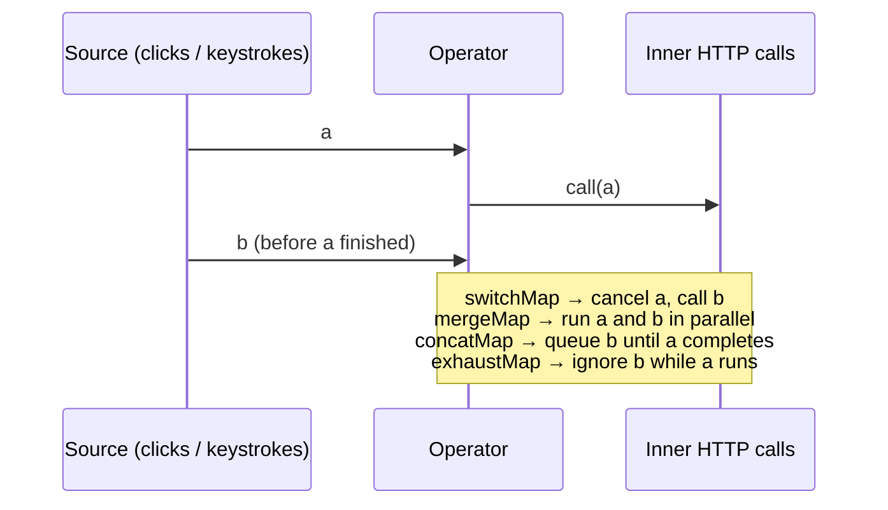

# RxJS for Angular Developers

## Observable basics

```typescript
import { Observable, of, from, interval, fromEvent, timer, Subject, BehaviorSubject, ReplaySubject } from 'rxjs';

const obs$ = new Observable<number>((sub) => {
  sub.next(1); sub.next(2);
  setTimeout(() => { sub.next(3); sub.complete(); }, 100);
  return () => console.log('teardown');
});

obs$.subscribe({ next: (v) => console.log('v', v), complete: () => console.log('done') });
```

!!! output "Output"
    ```text
    v 1
    v 2
    v 3
    done
    teardown
    ```

**Cold** (HttpClient, `of`, `interval`): each subscriber gets its own execution.
**Hot** (Subjects, `fromEvent`): executions are shared, and late subscribers miss past values.

## Subjects

| Subject | Initial value | Replays to late subscribers |
|---|---|---|
| `Subject` | no | nothing |
| `BehaviorSubject(init)` | yes | last value |
| `ReplaySubject(n)` | no | last *n* values |
| `AsyncSubject` | no | last value, only on complete |

```typescript
const s = new BehaviorSubject(0);
s.next(1);
s.subscribe((v) => console.log('A', v));   // A 1
s.next(2);                                 // A 2
s.subscribe((v) => console.log('B', v));   // B 2
```

## The operators you'll use 95% of the time

| Category | Operators |
|---|---|
| Transform | `map`, `scan`, `pluck`→`map`, `toArray` |
| Filter | `filter`, `distinctUntilChanged`, `debounceTime`, `throttleTime`, `take`, `takeWhile`, `first`, `skip` |
| Combine | `combineLatest`, `forkJoin`, `merge`, `concat`, `withLatestFrom`, `zip`, `startWith` |
| Higher-order | `switchMap`, `mergeMap`, `concatMap`, `exhaustMap` |
| Error | `catchError`, `retry({ count, delay })`, `throwError` |
| Utility | `tap`, `finalize`, `delay`, `timeout`, `shareReplay`, `share` |
| Lifecycle | `takeUntilDestroyed`, `takeUntil` |

### Higher-order mapping: the #1 interview topic



| Operator | Use case in the food app |
|---|---|
| `switchMap` | **search-as-you-type**: only the latest query matters |
| `mergeMap` | fire-and-forget parallel uploads, analytics |
| `concatMap` | ordered writes (cart line updates must apply in order) |
| `exhaustMap` | **"Place order" button**: ignore double clicks while a request is in flight |

```typescript
// Live search (restaurant-list.page.ts)
toObservable(this.query).pipe(
  debounceTime(300),
  distinctUntilChanged((a, b) => JSON.stringify(a) === JSON.stringify(b)),
  switchMap((q) => this.api.search(q).pipe(
    map((data) => ({ status: 'ok', data })),
    startWith({ status: 'loading' }),
    catchError(() => of({ status: 'error' })),
  )),
);

// Polling until delivered (order-api.ts)
timer(0, 3000).pipe(
  switchMap(() => this.get(id)),
  distinctUntilChanged((a, b) => a.status === b.status),
  takeWhile((o) => o.status !== 'DELIVERED' && o.status !== 'CANCELLED', true),
);

// Double-submit protection
fromEvent(button, 'click').pipe(exhaustMap(() => this.orders.place(req)));
```

### Combining

```typescript
forkJoin({ r: api.restaurant(id), m: api.menu(id) })        // wait for ALL to complete (parallel)
  .subscribe(({ r, m }) => console.log(r.name, m.length));   // Spice Route 4

combineLatest([filters$, sort$]).pipe(map(([f, s]) => ({ ...f, sort: s })));  // whenever ANY emits (after all emitted once)
```

## Unsubscribing: the decision table

| Situation | Do |
|---|---|
| Template | `async` pipe or `toSignal()`, both automatic |
| Component code | `.pipe(takeUntilDestroyed(this.destroyRef))` |
| HttpClient one-shot | completes by itself (still cancel with `switchMap` on navigation) |
| Service singleton | lives forever, so subscriptions are fine if intentional |
| `interval`, `fromEvent`, store selects | **must** unsubscribe |

## Sharing

```typescript
readonly config$ = this.http.get<Config>('/api/config').pipe(shareReplay({ bufferSize: 1, refCount: true }));
```

## Interview corner

??? question "What's the difference between `switchMap`, `mergeMap`, `concatMap` and `exhaustMap`?"
    All four map each source value to an inner observable and flatten it. They differ in **concurrency policy**:
    switch cancels the previous inner, merge runs all concurrently, concat queues, and exhaust ignores new values while busy.
    (See the table above for when to use each.)

??? question "`forkJoin` never emits. Why?"
    `forkJoin` emits only when **every** source completes. An `interval`, a Subject or a store select never completes.
    Use `combineLatest`, or add `take(1)`.

??? question "Why is `shareReplay(1)` without `refCount` a potential leak?"
    The source subscription stays alive forever, even after all subscribers leave. Use
    `shareReplay({ bufferSize: 1, refCount: true })` unless you deliberately want a permanent cache.

??? question "Signals or RxJS for a typeahead?"
    Both. Hold the query text in a signal (UI state). Use `toObservable` + `debounceTime` + `switchMap` for the
    time-based async part, and `toSignal` back for the template. That's exactly what the food app's list page does.
