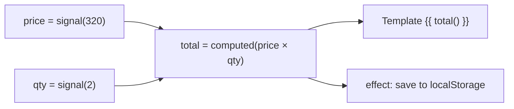
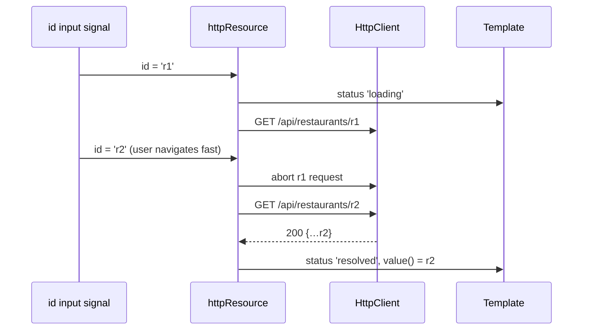

# Signals

A **signal** is a wrapper around a value that **notifies consumers when it changes**. Reading a signal inside a
reactive context (template, `computed`, `effect`) **registers a dependency** automatically.



## Core API

```typescript
import { signal, computed, effect, untracked, linkedSignal } from '@angular/core';

const price = signal(320);                      // WritableSignal<number>
const qty = signal(2);
const total = computed(() => price() * qty());  // Signal<number>, lazy + memoised

console.log(total());   // 640
qty.set(3);
console.log(total());   // 960
qty.update((q) => q + 1);
console.log(total());   // 1280

const readonlyQty = qty.asReadonly();           // expose without set/update
```

!!! output "Output"
    ```text
    640
    960
    1280
    ```

### Equality

```typescript
const user = signal({ id: 1, name: 'Asha' }, { equal: (a, b) => a.id === b.id });
user.set({ id: 1, name: 'Changed' });   // no notification: "equal"
```

Default equality is `Object.is`, so **mutating an object/array in place does not notify**. Always set a new reference.

### `computed`: derived, read-only, lazy

```typescript
const items = signal([{ n: 'a', p: 100 }, { n: 'b', p: 250 }]);
const expensive = computed(() => {
  console.log('recomputing');
  return items().filter((i) => i.p > 200);
});
expensive(); expensive();          // logs "recomputing" ONCE (memoised)
items.update((xs) => [...xs, { n: 'c', p: 999 }]);
expensive();                        // logs again
```

!!! output "Output"
    ```text
    recomputing
    recomputing
    ```

Dependencies are **dynamic**: only signals actually read during the last run are tracked.

```typescript
const showDetails = signal(false);
const label = computed(() => (showDetails() ? `${name()} (${email()})` : name()));
// while showDetails() is false, changes to email() do NOT recompute label
```

### `effect`: side effects

```typescript
constructor() {
  effect((onCleanup) => {
    const lines = this.cart.lines();                     // tracked
    const user = untracked(() => this.auth.user());      // NOT tracked
    localStorage.setItem('cart', JSON.stringify(lines));
    const t = setTimeout(() => analytics.track('cart', user?.id), 500);
    onCleanup(() => clearTimeout(t));
  });
}
```

!!! warning "Effects are for syncing with the *outside world*"
    Use them for localStorage, logging, analytics, imperative 3rd-party widgets, and `document.title`.
    **Don't** use them to copy one signal into another: that's `computed` or `linkedSignal`.
    Writing signals inside effects is allowed since v19, but it's a code smell when it's used to derive state.

Effects run **asynchronously** during change detection (component effects run before their view is checked).
In tests, flush them with `TestBed.tick()`.

### `linkedSignal`: writable derived state (v19+, stable v20)

```typescript
// Selected size resets to the first option whenever the product changes, but the user can still change it.
readonly product = input.required<Product>();
readonly size = linkedSignal(() => this.product().sizes[0]);

// Advanced form: keep previous selection if still valid
readonly selected = linkedSignal<Option[], Option | undefined>({
  source: this.options,
  computation: (opts, prev) => opts.find((o) => o.id === prev?.value?.id) ?? opts[0],
});
```

```text
product = Pizza (sizes S,M,L)   → size() = 'S'
size.set('L')                   → size() = 'L'
product = Burger (sizes R,XL)   → size() = 'R'   (reset by source)
```

### `resource` / `httpResource` / `rxResource` (stable v22)

Async data as signals: `value()`, `status()`, `isLoading()`, `error()`, `hasValue()`, `reload()`, `set()`.

```typescript
readonly id = input.required<string>();
readonly restaurant = httpResource<Restaurant>(() => `/api/restaurants/${this.id()}`);
readonly reviews = rxResource({
  params: () => ({ id: this.id(), page: this.page() }),
  stream: ({ params }) => this.api.reviews(params.id, params.page),   // Observable
});
```



### Signal-based component APIs

| API | Since | Purpose |
|---|---|---|
| `input()` / `input.required()` | 17.1 | inputs as signals |
| `model()` | 17.2 | two-way binding |
| `output()` | 17.3 | events (not a signal, same style) |
| `viewChild()` / `viewChildren()` / `contentChild()` / `contentChildren()` | 17.2 | queries as signals |
| `afterRenderEffect()` | 19 | DOM effects in render phases |

### RxJS interop

```typescript
import { toSignal, toObservable, takeUntilDestroyed, outputFromObservable, rxResource } from '@angular/core/rxjs-interop';

readonly orders = toSignal(this.api.myOrders(), { initialValue: [] });  // subscribes now, unsubscribes on destroy
readonly q$ = toObservable(this.q);                                      // emits via effect (async)
```

## Signals under the hood (for senior interviews)

- A **producer** (signal) keeps a version number. A **consumer** (computed, effect, template) records the producers
  and versions it read.
- On `set`, the producer bumps its version and **pushes a "dirty" notification** to live consumers (no values are pushed).
- When a consumer is read, it **pulls**: it checks whether any producer version changed, and recomputes only then.
- This push-dirty/pull-value model is **glitch-free**: you never observe a half-updated state, because `computed` is
  recomputed lazily, in the right order, once.
- Templates are consumers, so a signal change marks exactly the views that read it as needing refresh. That's
  the basis of **zoneless** change detection.

## Common mistakes

| Mistake | Fix |
|---|---|
| `items().push(x)` | `items.update((a) => [...a, x])` |
| Copying signal → signal in an effect | `computed` / `linkedSignal` |
| Reading a signal in a `setTimeout` and expecting reactivity | reactivity only exists in reactive contexts |
| Calling `toSignal()` in a method | call it once in a field initializer (injection context) |
| `effect()` outside an injection context | create in the constructor/field, or pass `{ injector }` |
| Expensive work in `computed` that reads many signals | split into smaller computeds |

## Interview corner

??? question "Signal vs BehaviorSubject?"
    Both hold a current value. Signals are synchronous, need no subscription management, track dependencies automatically
    (`computed`), are glitch-free and integrate with change detection. BehaviorSubject has the full operator toolbox and
    works with async event streams. Use signals for state, and Subjects only when you need stream semantics.

??? question "Is `computed` eager or lazy? What if nobody reads it?"
    It's lazy. It computes on first read and recomputes only when read after a dependency changed. If nobody reads it, it never runs.

??? question "When does an effect run?"
    At least once, after creation, during the next change detection. It then re-runs (asynchronously, batched) when
    any signal it read changes. Multiple synchronous writes cause **one** run.

??? question "What problem does `linkedSignal` solve?"
    "State that resets when an input changes but is locally editable". Before, that needed `ngOnChanges` plus a separate
    signal, or an effect writing to a signal (with glitch and ordering problems).
