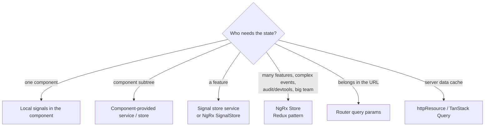
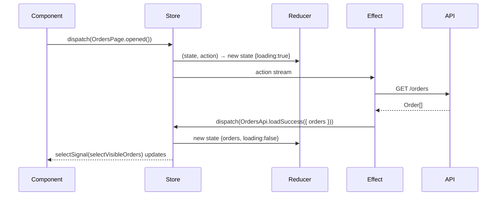

# State Management

## Choosing a level



## Level 1–2: a signal store service (no library)

The food app's cart, with private writable state, public read-only signals and intention-revealing methods:

```typescript title="features/cart/cart.store.ts"
--8<-- "src/app/features/cart/cart.store.ts"
```

!!! output "Example interaction"
    ```text
    add(Butter Chicken ₹320) → count 1, subtotal ₹320.00, delivery ₹30.00, GST ₹16.00, total ₹366.00
    add(another restaurant's item) → returns false (single-restaurant rule)
    add(₹499 worth) → delivery FREE
    ```

## Level 3: NgRx SignalStore (`@ngrx/signals`)

```typescript
import { signalStore, withState, withComputed, withMethods, patchState, withHooks } from '@ngrx/signals';
import { rxMethod } from '@ngrx/signals/rxjs-interop';

type OrdersState = { orders: Order[]; loading: boolean; filter: OrderStatus | 'ALL' };

export const OrdersStore = signalStore(
  { providedIn: 'root' },
  withState<OrdersState>({ orders: [], loading: false, filter: 'ALL' }),
  withComputed(({ orders, filter }) => ({
    visible: computed(() => (filter() === 'ALL' ? orders() : orders().filter((o) => o.status === filter()))),
    activeCount: computed(() => orders().filter((o) => o.status !== 'DELIVERED').length),
  })),
  withMethods((store, api = inject(OrderApi)) => ({
    setFilter: (filter: OrdersState['filter']) => patchState(store, { filter }),
    load: rxMethod<void>(pipe(
      tap(() => patchState(store, { loading: true })),
      switchMap(() => api.myOrders().pipe(
        tapResponse({ next: (orders) => patchState(store, { orders }), error: console.error,
                      finalize: () => patchState(store, { loading: false }) }),
      )),
    )),
  })),
  withHooks({ onInit: (store) => store.load() }),
);

// component
protected readonly store = inject(OrdersStore);
// template: @for (o of store.visible(); track o.id) …   {{ store.activeCount() }}
```

Also available: `withEntities` (normalised collections), `withProps`, `signalStoreFeature` (reusable features
such as `withRequestStatus()`), `withLinkedState`, and the `withDevtools` integration from ngrx-toolkit.

## Level 4: NgRx Store (Redux)



```typescript
export const OrdersPage = createActionGroup({ source: 'Orders Page', events: { Opened: emptyProps() } });
export const OrdersApi = createActionGroup({
  source: 'Orders API',
  events: { 'Load Success': props<{ orders: Order[] }>(), 'Load Failure': props<{ error: string }>() },
});

export const ordersFeature = createFeature({
  name: 'orders',
  reducer: createReducer(
    { orders: [] as Order[], loading: false },
    on(OrdersPage.opened, (s) => ({ ...s, loading: true })),
    on(OrdersApi.loadSuccess, (s, { orders }) => ({ ...s, orders, loading: false })),
  ),
});

export const loadOrders = createEffect(
  (actions$ = inject(Actions), api = inject(OrderApi)) =>
    actions$.pipe(ofType(OrdersPage.opened), exhaustMap(() =>
      api.myOrders().pipe(map((orders) => OrdersApi.loadSuccess({ orders })),
                          catchError((e) => of(OrdersApi.loadFailure({ error: e.message })))))),
  { functional: true },
);

// app.config.ts
provideStore({ [ordersFeature.name]: ordersFeature.reducer }), provideEffects({ loadOrders }), provideStoreDevtools()
// component
orders = inject(Store).selectSignal(ordersFeature.selectOrders);
```

## Comparison

| | Signal service | NgRx SignalStore | NgRx Store |
|---|---|---|---|
| Boilerplate | minimal | low | high |
| Devtools / time travel | no | via toolkit | yes |
| Event-driven (many reducers react to one action) | no | events plugin | **yes** |
| Learning curve | none | low | high |
| Sweet spot | small/medium apps, feature state | most new apps | large enterprise, many teams |

## Server state vs client state

Don't put **server cache** (lists from APIs) into a global store by reflex. `httpResource` or `rxResource` per page,
or a query library, handles caching, refetching and loading states. Keep stores for **client state**: cart, wizard
progress, UI preferences, selections.

## Interview corner

??? question "When is NgRx overkill?"
    When state is mostly server data shown per page and little is shared. Signal services or SignalStore give 90% of
    the benefit at 10% of the ceremony. NgRx Store pays off with many developers, complex cross-feature workflows,
    strict audit or undo needs, and heavy devtools use.

??? question "Why make store state private and expose `asReadonly()`?"
    Encapsulation: only the store's methods can change state, so every mutation goes through a named intent
    (`add`, `clear`). That's easy to log, test and reason about, and it gives you a single place for invariants
    (the single-restaurant rule).
