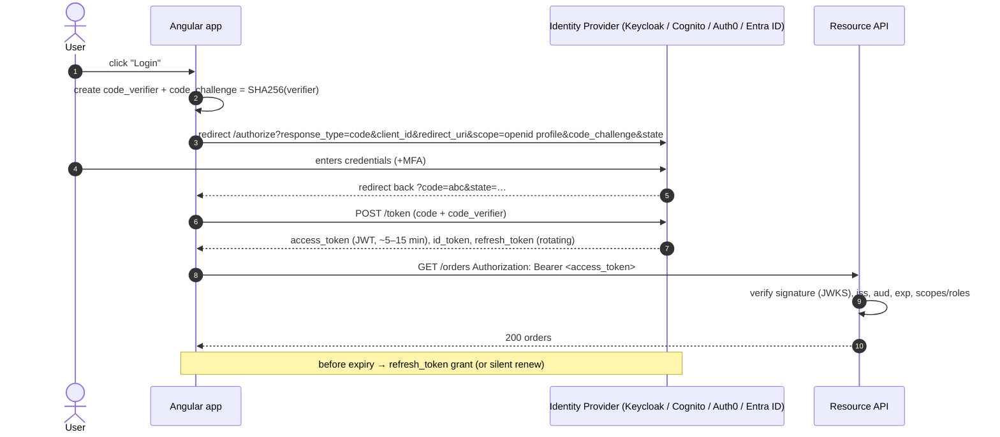
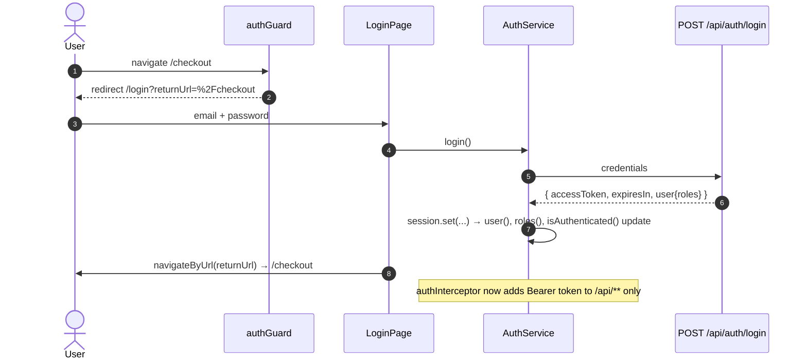
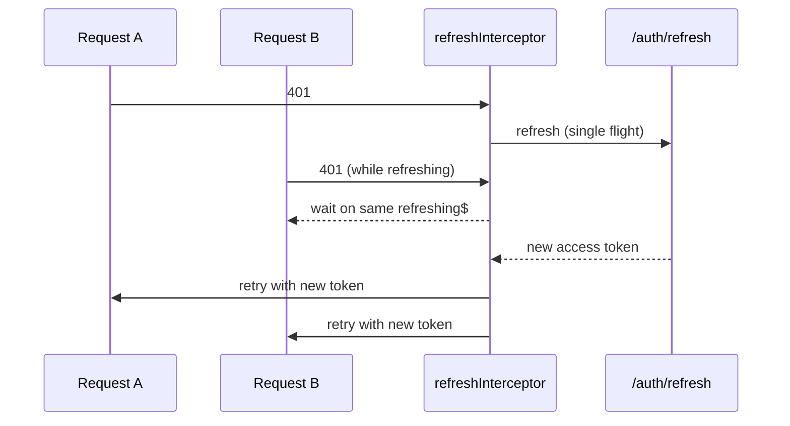

# Authentication

## Options at a glance

| Approach | Tokens live in | XSS exposure | Complexity | Recommendation |
|---|---|---|---|---|
| **BFF** (Backend-for-Frontend) | httpOnly, Secure, SameSite cookie (server holds tokens) | **lowest** | server component needed | ✅ best for high-security apps |
| **OIDC Authorization Code + PKCE** in SPA | memory (+ refresh via silent renew / rotating refresh token) | medium | library handles it | ✅ standard SPA choice |
| Custom login → JWT in `localStorage` | localStorage | **high** (any XSS steals it) | low | ❌ avoid for production |
| Implicit flow | URL fragment | high | — | ❌ deprecated by OAuth 2.1 |

## OIDC Authorization Code + PKCE flow



### With `angular-oauth2-oidc`

```bash
npm i angular-oauth2-oidc
```

```typescript title="app.config.ts"
import { provideOAuthClient, OAuthService, AuthConfig } from 'angular-oauth2-oidc';

const authConfig = (env: AppEnvironment): AuthConfig => ({
  issuer: env.auth.issuer,                     // per-environment (dev/qa/uat/prod)
  clientId: env.auth.clientId,
  redirectUri: window.location.origin + '/auth/callback',
  responseType: 'code',                        // Authorization Code…
  scope: 'openid profile email offline_access orders:read orders:write',
  useSilentRefresh: false,                     // …with rotating refresh tokens
  showDebugInformation: !env.production,
});

export const appConfig: ApplicationConfig = {
  providers: [
    provideHttpClient(withInterceptors([authInterceptor])),
    provideOAuthClient({ resourceServer: { allowedUrls: [environment.apiBaseUrl], sendAccessToken: true } }),
    provideAppInitializer(async () => {
      const oauth = inject(OAuthService);
      oauth.configure(authConfig(inject(APP_ENV)));
      await oauth.loadDiscoveryDocumentAndTryLogin();   // handles ?code= on callback
      oauth.setupAutomaticSilentRefresh();
    }),
  ],
};
```

```typescript title="auth.service.ts (OIDC flavour)"
@Injectable({ providedIn: 'root' })
export class OidcAuthService {
  private readonly oauth = inject(OAuthService);
  private readonly _claims = signal(this.oauth.getIdentityClaims());
  readonly user = computed(() => this._claims() as { name: string; email: string; roles?: string[] } | null);
  readonly isAuthenticated = computed(() => !!this.user());

  constructor() {
    this.oauth.events.pipe(takeUntilDestroyed()).subscribe(() => this._claims.set(this.oauth.getIdentityClaims()));
  }
  login(returnUrl = '/') { this.oauth.initCodeFlow(returnUrl); }
  logout() { this.oauth.logOut(); }                    // also ends the IdP session (RP-initiated logout)
  token() { return this.oauth.getAccessToken(); }
}
```

Alternatives: `angular-auth-oidc-client`, `@auth0/auth0-angular`, MSAL Angular (`@azure/msal-angular`) for Entra ID,
and AWS Amplify for Cognito.

## The food app's simple session (self-contained demo)

The example app uses a username/password endpoint (mocked) so it runs without an IdP. The service structure
(signals for user, roles and isAuthenticated, plus `token()` for the interceptor) is the same one you'd put on top of OIDC.

```typescript title="core/auth/auth.service.ts"
--8<-- "src/app/core/auth/auth.service.ts"
```



## Attaching the token

```typescript title="core/http/auth.interceptor.ts"
--8<-- "src/app/core/http/auth.interceptor.ts"
```

!!! warning "Only send tokens to your own API"
    The URL check prevents leaking the bearer token to third parties (maps, analytics, CDN).
    OIDC libraries do the same with `allowedUrls`.

## Token refresh with request queueing (custom JWT backends)

```typescript
let refreshing$: Observable<string> | null = null;

export const refreshInterceptor: HttpInterceptorFn = (req, next) => {
  const auth = inject(AuthService);
  return next(req).pipe(
    catchError((err: HttpErrorResponse) => {
      if (err.status !== 401 || req.url.endsWith('/auth/refresh')) return throwError(() => err);
      // Single-flight: concurrent 401s share ONE refresh call
      refreshing$ ??= auth.refresh().pipe(finalize(() => (refreshing$ = null)), shareReplay(1));
      return refreshing$.pipe(
        switchMap((token) => next(req.clone({ setHeaders: { Authorization: `Bearer ${token}` } }))),
      );
    }),
  );
};
```



## BFF pattern (most secure)

```mermaid
sequenceDiagram
    participant B as Browser (Angular)
    participant BFF as BFF (Spring Cloud Gateway / Node / YARP)
    participant IdP
    participant API
    B->>BFF: GET /bff/login
    BFF->>IdP: code flow + PKCE (server side)
    IdP-->>BFF: tokens (kept server side)
    BFF-->>B: Set-Cookie: SESSION=…; HttpOnly; Secure; SameSite=Strict
    B->>BFF: GET /api/orders (cookie, X-XSRF-TOKEN)
    BFF->>API: forward with Bearer token
```

On the Angular side there's no token handling at all: `withCredentials` and `withXsrfConfiguration()` are enough.

## Interview corner

??? question "Why PKCE for SPAs?"
    An SPA can't keep a client secret. PKCE binds the authorization code to a one-time `code_verifier` that only the
    initiating app knows, so an intercepted code is useless. OAuth 2.1 makes PKCE mandatory for all clients.

??? question "localStorage vs sessionStorage vs memory vs cookie for tokens?"
    Any JS-readable storage (local or session storage, memory) can be stolen by XSS. Memory survives the shortest time
    (lost on reload, so it's paired with refresh). httpOnly cookies can't be read by JS (that's the BFF approach) but
    need CSRF protection. Pick based on threat model, and prioritise **preventing XSS** (CSP, no `innerHTML`, sanitisation).

??? question "How do you handle logout across tabs?"
    Listen to the `storage` event (or a `BroadcastChannel('auth')`) and clear the session in every tab. With OIDC, also
    do RP-initiated logout at the IdP, and use front- or back-channel logout for SSO.
