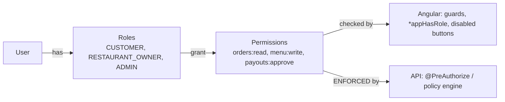
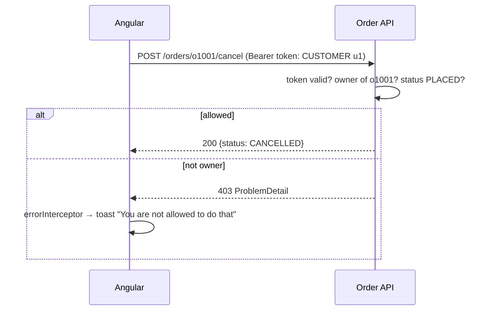

# Authorization

## Model



Prefer **permission checks** (`menu:write`) over **role checks** (`ADMIN`) in code: roles change, permissions are stable.

## 1. Route level: guards

```typescript title="core/auth/auth.guards.ts"
--8<-- "src/app/core/auth/auth.guards.ts"
```

```typescript
{ path: 'checkout', canActivate: [authGuard], … }                        // authenticated
{ path: 'admin', canMatch: [roleGuard('ADMIN')], loadChildren: … }       // authorized, chunk never downloaded
{ path: 'restaurant/:id/edit', canMatch: [permissionGuard('menu:write')], … }
```

## 2. Element level: structural directive

```typescript title="shared/directives/has-role.directive.ts"
--8<-- "src/app/shared/directives/has-role.directive.ts"
```

```html
<a *appHasRole="['ADMIN']" routerLink="/admin">Admin</a>
<button *appHasRole="['ADMIN', 'RESTAURANT_OWNER']" (click)="editMenu()">Edit menu</button>
```

!!! output "Output"
    ```text
    customer@food.dev → header: Restaurants · Orders · Cart · Logout
    admin@food.dev    → header: Restaurants · Orders · Admin · Cart · Logout
    customer visiting /admin → /forbidden (403 page)
    ```

## 3. Data level: the API decides



## Permission-based variant (fine-grained)

```typescript
@Injectable({ providedIn: 'root' })
export class Permissions {
  private readonly auth = inject(AuthService);
  private readonly map: Record<Role, string[]> = {
    CUSTOMER: ['orders:read:own', 'orders:create'],
    RESTAURANT_OWNER: ['menu:write', 'orders:read:restaurant'],
    ADMIN: ['*'],
  };
  readonly granted = computed(() => new Set(this.auth.roles().flatMap((r) => this.map[r])));
  can = (perm: string) => this.granted().has('*') || this.granted().has(perm);
}

export const permissionGuard = (perm: string): CanMatchFn => () =>
  inject(Permissions).can(perm) || inject(Router).createUrlTree(['/forbidden']);
```

In real systems, load permissions from the token's claims or a `/me/permissions` endpoint rather than hard-coding them.

## Tested

`auth.guards.spec.ts` and `has-role.directive.spec.ts` in the example app cover redirects, the 403 path and reactive
show/hide when roles change ([Unit testing](../testing/unit-testing.md)).

## Interview corner

??? question "A user edits localStorage to give themselves ADMIN. What happens?"
    The UI might show admin links (if roles come from localStorage), but every admin API call fails with 403, because
    the server validates the **signed** token and its own data. That's why authorization must live in the backend.

??? question "Hide or disable unauthorized actions?"
    Hide actions the user can never perform (less noise). Disable, with an explanation tooltip, actions they could
    perform under other conditions ("Cancel" after the order is accepted).
