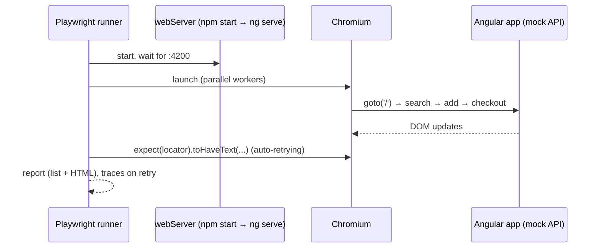

# E2E Testing with Playwright

```bash
npm i -D @playwright/test
npx playwright install chromium        # browsers (CI: npx playwright install --with-deps)
```

```typescript title="playwright.config.ts (food app)"
--8<-- "playwright.config.ts"
```

```typescript title="e2e/order-flow.spec.ts (food app)"
--8<-- "e2e/order-flow.spec.ts"
```



## Commands

```bash
npx playwright test                       # headless, all tests
npx playwright test --ui                  # interactive UI mode
npx playwright test --headed --debug      # step through
npx playwright test -g "admin"            # filter by title
npx playwright show-report                # open HTML report
npx playwright codegen http://localhost:4200   # record a test
BASE_URL=https://qa.food.example.com npx playwright test   # run against QA
```

## Best practices

- Use **user-facing locators**: `getByRole`, `getByLabel`, `getByText`, `getByTestId`, not CSS chains.
- Use web-first assertions (`await expect(locator).toBeVisible()`), which auto-wait. Never `waitForTimeout`.
- Isolate tests: each test logs in itself, or uses `storageState` from a setup project.
- Mock third-party services with `page.route('**/maps/**', r => r.fulfill({ json: {...} }))`.
- Run against **dev with mock API** on every PR, and against **QA** after deploy (smoke suite).

!!! note "Lessons from writing these tests"
    The first run of `order-flow.spec.ts` failed twice: once on an arithmetic mistake in the expected total
    (₹366, not ₹376), and once because the test navigated to `/admin` **before** login had finished.
    The fix was to wait for a visible post-login state (`Hi, Asha`) instead of adding a sleep.
