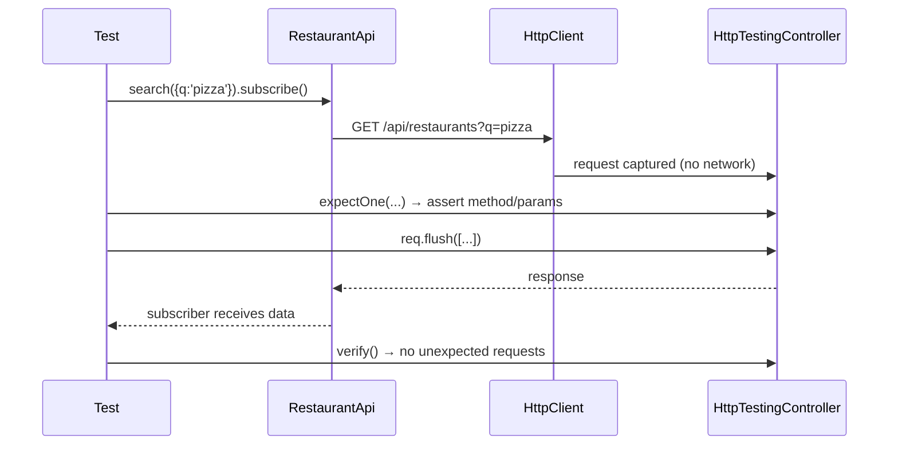

# Unit Testing with Vitest

Since **v21**, new projects use **Vitest** through the `@angular/build:unit-test` builder. Karma and Jasmine still
work (`--test-runner=karma`) but are in maintenance.

```json title="angular.json"
"test": { "builder": "@angular/build:unit-test" }
```

```json title="tsconfig.spec.json"
{ "compilerOptions": { "types": ["vitest/globals"] }, "include": ["src/**/*.d.ts", "src/**/*.spec.ts"] }
```

### Jasmine → Vitest cheat sheet

| Jasmine | Vitest |
|---|---|
| `jasmine.createSpy()` | `vi.fn()` |
| `spyOn(obj, 'm').and.returnValue(x)` | `vi.spyOn(obj, 'm').mockReturnValue(x)` |
| `.and.callFake(fn)` | `.mockImplementation(fn)` |
| `toHaveBeenCalledWith` | same |
| `jasmine.clock().tick(1000)` | `vi.useFakeTimers(); vi.advanceTimersByTime(1000)` |
| `fakeAsync` / `tick` (zone) | `await fixture.whenStable()` / fake timers (zoneless) |

## 1. Pure unit test, no TestBed (pipe)

```typescript title="shared/pipes/inr.pipe.spec.ts"
--8<-- "src/app/shared/pipes/inr.pipe.spec.ts"
```

```typescript title="features/checkout/pincode.validator.spec.ts"
--8<-- "src/app/features/checkout/pincode.validator.spec.ts"
```

## 2. Signal store

```typescript title="features/cart/cart.store.spec.ts"
--8<-- "src/app/features/cart/cart.store.spec.ts"
```

!!! tip "`TestBed.tick()`"
    Effects run during change detection. In a service test there's no component, so call `TestBed.tick()` to flush
    pending effects (the localStorage persistence test above).

## 3. HTTP service with `HttpTestingController`

```typescript title="core/api/restaurant-api.spec.ts"
--8<-- "src/app/core/api/restaurant-api.spec.ts"
```



## 4. Interceptor

```typescript title="core/http/auth.interceptor.spec.ts"
--8<-- "src/app/core/http/auth.interceptor.spec.ts"
```

## 5. Functional guards

```typescript title="core/auth/auth.guards.spec.ts"
--8<-- "src/app/core/auth/auth.guards.spec.ts"
```

## Mocking patterns

```typescript
// Fake object
{ provide: AuthService, useValue: { token: () => 'abc', isAuthenticated: () => true } }

// Spy on a real service method
const api = TestBed.inject(OrderApi);
vi.spyOn(api, 'place').mockReturnValue(of(order));

// Module mock (rarely needed in Angular, DI is better)
vi.mock('./analytics', () => ({ track: vi.fn() }));

// Fake timers (debounce, polling)
vi.useFakeTimers();
store.search('pi');
vi.advanceTimersByTime(300);
```

## Coverage

```bash
npm i -D @vitest/coverage-v8
ng test --watch=false --coverage
```

Set thresholds in `vitest-base.config.ts` (`ng g config vitest`) to fail CI below e.g. 80% lines.

## Interview corner

??? question "Why are some tests written without TestBed?"
    Pipes, validators and pure functions don't need DI. Instantiating them directly is ~100× faster and clearer.
    Use TestBed only when you need injection, templates or change detection.

??? question "How do you test code that uses `inject()` outside a component?"
    `TestBed.runInInjectionContext(() => myGuard(route, state))`, or `TestBed.inject(Service)`, which creates the
    service in an injection context.
